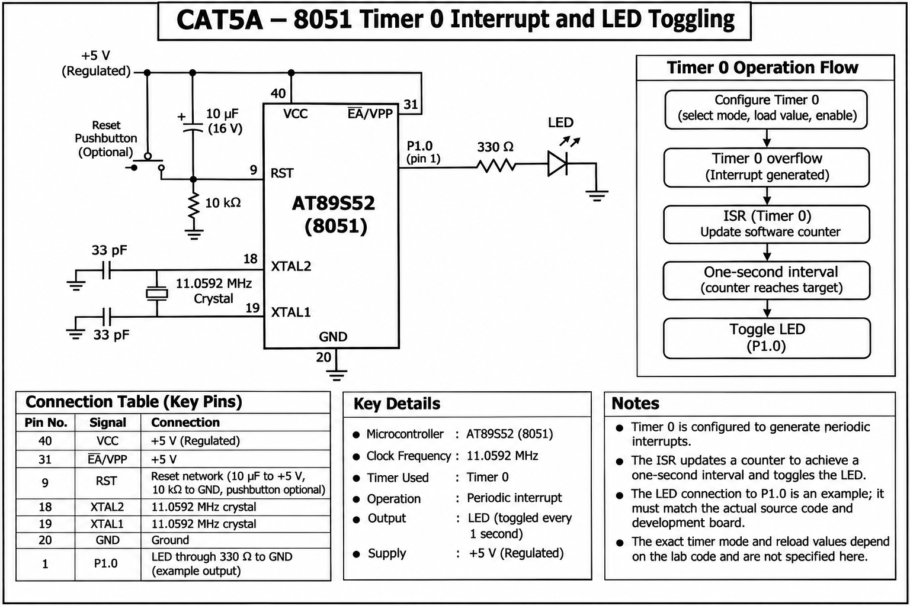

# EXPERIMENT DETAILS

**EXP:** CONTINUOUS ASSESSMENT 5 (CAT5)

**DATE:** 10/08/2026

**NAME OF EXP:** Timer and Interrupt Programming

**HARDWARE SETUP / PLATFORM:**
- Microcontroller: AT89S52 (8051)
- Crystal Frequency: 11.0592 MHz
- Software: Keil µVision
- Output: LED

**TASK NO:** CAT5A – Timer 0 Interrupt

## CIRCUIT DIAGRAM

## OBJECTIVE

- Configure Timer 0 of the 8051 microcontroller.
- Generate periodic interrupts using Timer 0.
- Toggle an LED at one-second intervals.
- Understand timer-based interrupt handling.

## CORE LOGIC

1. Configure Timer 0 in the required operating mode.
2. Load the appropriate timer initial values.
3. Enable Timer 0 interrupt using ET0.
4. Enable global interrupts using EA.
5. Start Timer 0 using TR0.
6. Execute the Timer 0 interrupt service routine whenever overflow occurs.
7. Maintain a counter to generate a one-second interval.
8. Toggle the LED after the required number of timer interrupts.
9. Repeat continuously.

## INFERENCE

Timer 0 was configured to generate periodic interrupts. The interrupt service routine was used to toggle the LED at one-second intervals, demonstrating timer operation and interrupt handling in the AT89S52 microcontroller.
