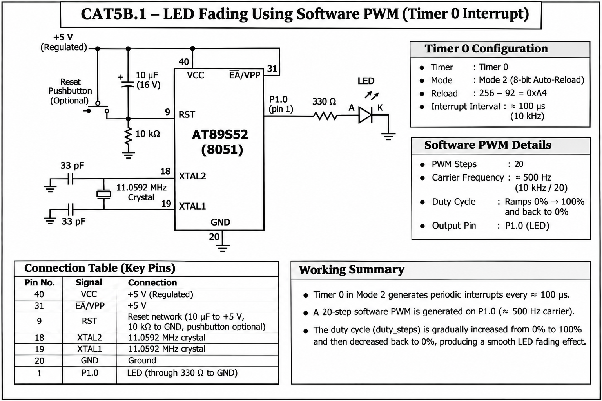

# EXPERIMENT DETAILS

**EXP:** CONTINUOUS ASSESSMENT 5 (CAT5)

**DATE:** 10/08/2026

**NAME OF EXP:** Hardware Timer and Interrupt-Based Timing for LED Fading, Pulse Generation, and Stepper Motor Control

**HARDWARE SETUP / PLATFORM:** AT89S52 (11.0592 MHz) + Keil C51 µVision

---

## TASK 5B.1: LED Fading Using Software PWM (Timer 0 Interrupt)

### 1. Hardware Setup & Circuit Diagram

- **MCU:** AT89S52 @ 11.0592 MHz
- **PWM Pin:** `P1.0` driving LED through a 330 Ω resistor.
- **Timer:** Timer 0, Mode 2 (8-bit auto-reload).
- **Timer Interrupt Interval:** Approximately 100 µs.
- **PWM Carrier Frequency:** Approximately 500 Hz.

### 2. Core Logic / Pseudocode / Code Base

**Working Principle:**

Timer 0 generates periodic interrupts at approximately 100 µs intervals. A 20-step software counter generates a 500 Hz PWM signal on P1.0. The duty cycle gradually increases from 0% to 100% and then decreases back to 0%, producing a smooth LED fading effect.

**Pseudocode:**

1. Configure Timer 0 in Mode 2.
2. Set the timer reload value to generate approximately 100 µs interrupts.
3. Enable Timer 0 interrupts and global interrupts.
4. Increment `pwm_tick` modulo 20 inside the interrupt service routine.
5. Set `P1.0` HIGH when `pwm_tick < duty_steps`; otherwise, set it LOW.
6. Every 500 timer interrupts, update the duty cycle.
7. Increase `duty_steps` up to 20 and then decrease it to 0.
8. Repeat continuously.

**Code Base:**

- Timer 0 Mode 2 provides automatic reload operation.
- Software PWM controls LED brightness through duty-cycle variation.
- The interrupt service routine handles periodic PWM updates.

**Build Note:** Rebuild `TASK5B_1.uvproj` in Keil µVision (C51) to regenerate `Objects/TASK5B_1.hex` before flashing the AT89S52 board.

### 3. Inference

Software PWM was successfully implemented using Timer 0 interrupts. Varying the duty cycle from 0% to 100% and back produces a smooth LED fading effect without noticeable flickering.
