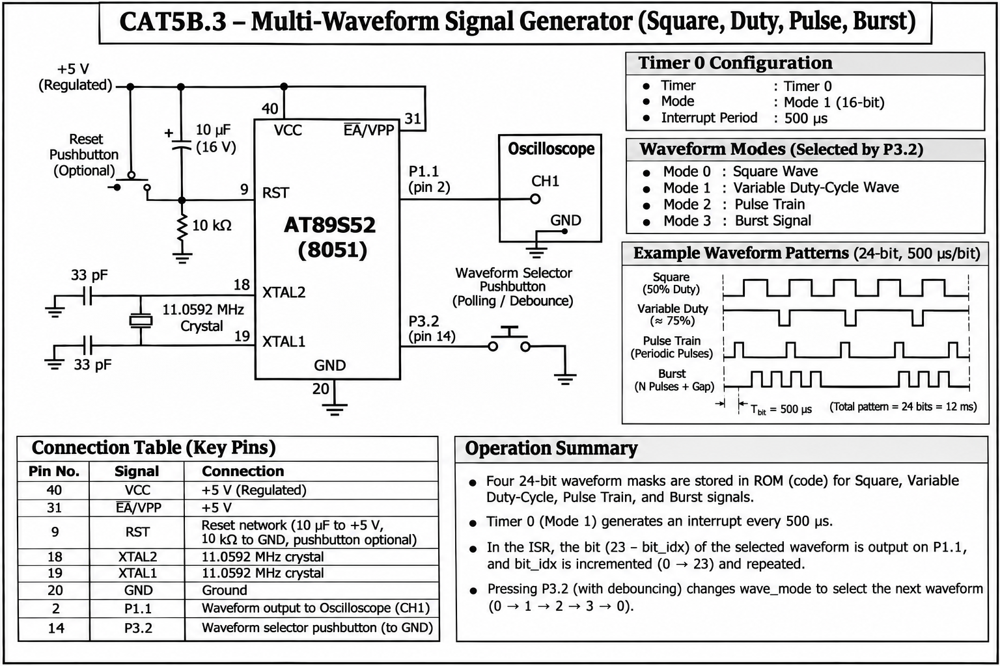

# EXPERIMENT DETAILS

**EXP:** CONTINUOUS ASSESSMENT 5 (CAT5)

**DATE:** 10/08/2026

**NAME OF EXP:** Hardware Timer and Interrupt-Based Timing for LED Fading, Pulse Generation, and Stepper Motor Control

**HARDWARE SETUP / PLATFORM:** AT89S52 (11.0592 MHz) + Keil C51 uVision + Oscilloscope

---

## TASK 5B.3: Multi-Waveform Signal Generator (Square, Duty, Pulse, Burst)

### 1. Hardware Setup & Circuit Diagram

- **MCU:** AT89S52 @ 11.0592 MHz
- **Signal Output:** `P1.1` → Oscilloscope Channel 1
- **Waveform Selector:** `P3.2` pushbutton
- **Waveform Modes:**
  - Square Wave
  - Variable Duty-Cycle Wave
  - Pulse Train
  - Burst Signal

### 2. Core Logic / Pseudocode / Code Base

**Working Principle:**

The signal generator uses 24-bit waveform patterns stored in ROM. Timer 0 generates an interrupt every 500 µs, and the ISR shifts the selected waveform pattern onto `P1.1` one bit at a time, starting from the most significant bit.

The waveform selector button connected to `P3.2` switches between the four available waveform modes.

**Pseudocode:**

1. Store the four 24-bit waveform masks in a ROM array.
2. Configure Timer 0 to generate interrupts at 500 µs intervals.
3. In the Timer 0 ISR:
   - Output bit `(23 - bit_idx)` to `P1.1`.
   - Increment `bit_idx` to move to the next bit.
4. Detect and debounce the button press on `P3.2`.
5. Update `wave_mode` to select the next waveform.

**Code Base:**

- `waveforms[4]` stores the four waveform patterns.
- `bit_idx` tracks the current bit position.
- `wave_mode` selects the active waveform.
- A parameterized ISR handles all four waveform types.

**Build Note:** Rebuild `TASK5B_3.uvproj` in Keil C51 uVision to regenerate `Objects/TASK5B_3.hex` before flashing the AT89S52 board.

### 3. Inference

Bit-slotted timer serialization enables multiple digital waveform patterns to be generated through a single GPIO pin. The system produces square waves, variable duty-cycle waves, pulse trains, and burst signals using Timer 0 interrupts.
