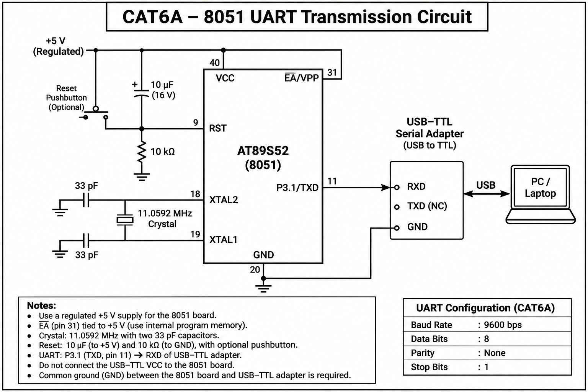

# CAT6A – 8051 UART Initialization and Character Transmission

## Experiment Details
- **Course:** 25CS2741 – Fundamentals of Internet of Things + Lab
- **Experiment:** UART Initialization and Character Transmission
- **Microcontroller:** AT89S52 (8051)
- **Software:** Keil µVision
- **Programming Language:** Embedded C

## Aim
To configure the UART of the AT89S52 microcontroller and transmit characters serially to a PC terminal.

## Hardware Requirements
- AT89S52 Development Board
- USB-to-TTL Converter
- USB Cable
- PC with PuTTY Terminal

## UART Configuration
- **Communication Mode:** 8-bit UART
- **Baud Rate:** 9600 bps
- **Stop Bits:** 1
- **Parity:** None
- **Communication:** Asynchronous Serial Communication

## Pin Configuration

| AT89S52 Pin | Connection |
|---|---|
| P3.1 (TXD) | USB-to-TTL RX |
| P3.0 (RXD) | USB-to-TTL TX |
| GND | USB-to-TTL GND |

## Circuit Diagram

## Task Description
- Initialize the UART in 8-bit mode.
- Configure the baud rate to 9600 bps.
- Transmit the message continuously:

  Hello from 8051

- Display the received characters on the PC using PuTTY.

## Algorithm
1. Initialize the UART registers.
2. Configure the baud rate.
3. Enable serial communication.
4. Load each character into the transmit buffer.
5. Wait until transmission is complete.
6. Continue transmitting the message.

## Source Files
- uart_tx.c – Embedded C source code.
- uart_tx.uvproj – Keil project file.
- Objects/uart_tx.hex – Compiled HEX file.
- circuit.png – Circuit diagram.

## Result
The UART of the AT89S52 microcontroller was configured successfully, and the message was transmitted serially to the PC terminal.
