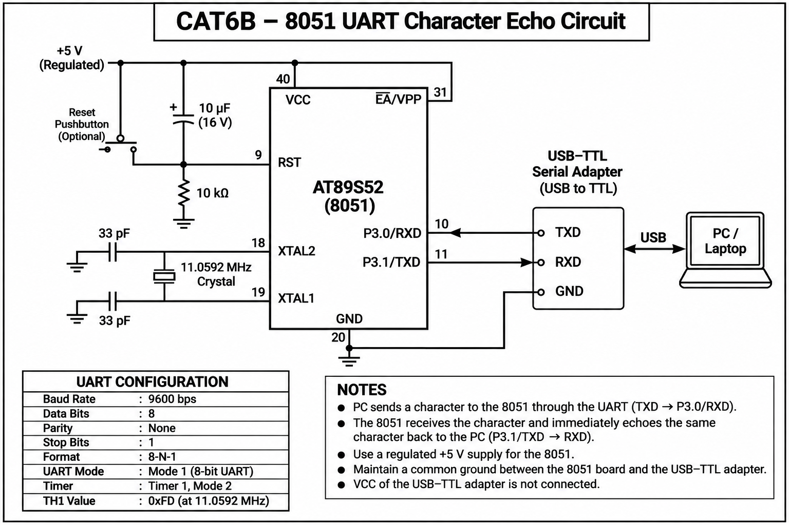

# EXPERIMENT DETAILS

**EXP:** CONTINUOUS ASSESSMENT 6 (CAT6)

**DATE:** 17/08/2026

**NAME OF EXP:** UART Driver and Serial Debugging

**HARDWARE SETUP / PLATFORM:**
- Microcontroller: AT89S52 (8051)
- Crystal Frequency: 11.0592 MHz
- Compiler: Keil µVision
- Serial Communication: USB-to-TTL Converter
- Terminal Software: PuTTY
- Baud Rate: 9600 bps

**TASK NO:** CAT6B – UART Character Echo

## CIRCUIT DIAGRAM

## CORE LOGIC

1. Initialize UART in Mode 1 (8-bit asynchronous communication).
2. Configure Timer 1 in Mode 2 for baud rate generation.
3. Set TH1 = 0xFD for 9600 baud at 11.0592 MHz.
4. Enable serial reception using SCON = 0x50.
5. Start Timer 1.
6. Wait until a character is received by checking the RI flag.
7. Read the received character from SBUF.
8. Clear the RI flag.
9. Transmit the same character back through UART.
10. Repeat continuously to echo every received character.

## UART CONFIGURATION

| Parameter | Configuration |
|---|---|
| UART Mode | Mode 1 |
| Baud Rate | 9600 bps |
| Data Bits | 8 |
| Parity | None |
| Stop Bits | 1 |
| Timer | Timer 1, Mode 2 |

## HARDWARE CONNECTIONS

| AT89S52 Pin | USB-to-TTL Pin |
|---|---|
| P3.0 / RXD (Pin 10) | TXD |
| P3.1 / TXD (Pin 11) | RXD |
| GND | GND |

A common ground connection is required between the 8051 board and the USB-to-TTL converter.

## INFERENCE

UART serial communication was successfully implemented using the AT89S52 microcontroller. The microcontroller receives characters from the PC through the serial interface and immediately transmits the same characters back. This demonstrates bidirectional serial communication using UART.
