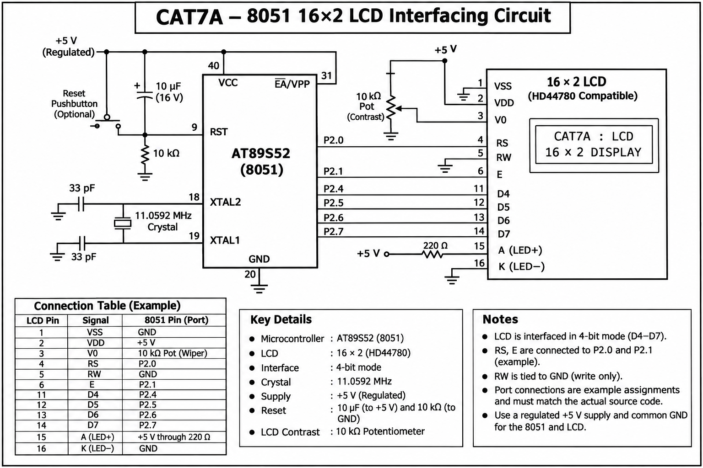

# EXPERIMENT DETAILS

**EXP:** CONTINUOUS ASSESSMENT 7 (CAT7)

**DATE:** 24/08/2026

**NAME OF EXP:** LCD Interfacing and Display Control

**HARDWARE SETUP / PLATFORM:**
- Microcontroller: AT89S52 (8051)
- Display: 16×2 LCD (HD44780 compatible)
- Interface: 4-bit mode
- Crystal Frequency: 11.0592 MHz
- Software: Keil µVision

**TASK NO:** CAT7A – LCD Initialization and Character Display

## CIRCUIT DIAGRAM

## OBJECTIVE

- Interface a 16×2 LCD with the AT89S52 microcontroller.
- Initialize the LCD in 4-bit communication mode.
- Implement LCD command and data functions.
- Display individual characters and strings on the LCD.
- Display information on both rows of the LCD.

## CORE LOGIC

1. Configure the microcontroller ports connected to the LCD.
2. Initialize the LCD using the required 4-bit initialization sequence.
3. Configure the LCD for two-line display and cursor settings.
4. Implement `lcd_cmd()` to send commands to the LCD.
5. Implement `lcd_data()` to send character data.
6. Send the required characters and strings to the LCD.
7. Display the output on the first and second rows.

## INFERENCE

The 16×2 LCD was successfully interfaced with the AT89S52 microcontroller using 4-bit communication. LCD initialization, command transmission, and character/string display operations were implemented.
