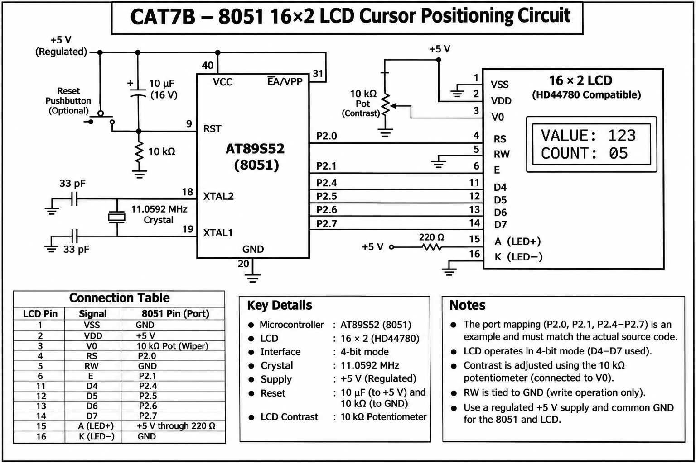

# EXPERIMENT DETAILS

**EXP:** CONTINUOUS ASSESSMENT 7 (CAT7)

**DATE:** 24/08/2026

**NAME OF EXP:** LCD Interfacing and Display Control

**HARDWARE SETUP / PLATFORM:**
- Microcontroller: AT89S52 (8051)
- Display: 16×2 LCD (HD44780 compatible)
- Interface: 4-bit mode
- Crystal Frequency: 11.0592 MHz
- Software: Keil µVision

**TASK NO:** CAT7B – LCD Cursor Positioning and Dynamic Value Display

## CIRCUIT DIAGRAM

## OBJECTIVE

- Implement cursor positioning on a 16×2 LCD.
- Display text at specific row and column positions.
- Display strings using a dedicated function.
- Display numerical values dynamically on the LCD.

## CORE LOGIC

1. Initialize the 16×2 LCD in 4-bit mode.
2. Implement `lcd_cmd()` to send LCD commands.
3. Implement `lcd_data()` to send character data.
4. Implement `lcd_goto(row, column)` to position the cursor.
5. Implement `lcd_puts(string)` to display strings.
6. Implement `lcd_print_number(value)` to display numerical values.
7. Update the LCD display with the required text and numerical values.

## INFERENCE

LCD cursor positioning and dynamic data display operations were implemented using the AT89S52 microcontroller. Text and numerical values can be displayed at specific positions on the 16×2 LCD.
