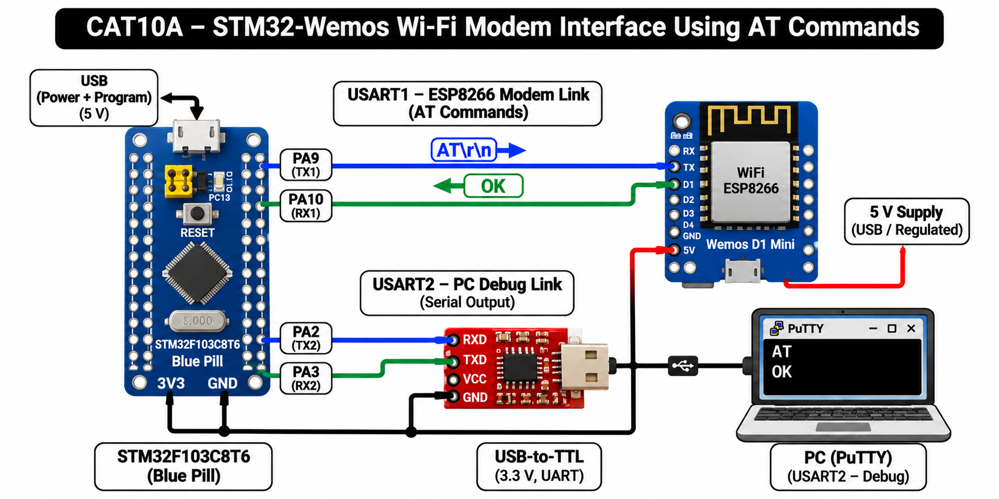

# CAT 10 — Task 10A: Establish STM32 ↔ Wemos UART Communication

## Experiment details

- **Course:** 25CS2741 — Fundamentals of Internet of Things + Lab
- **Assessment:** Continuous Lab Evaluation 10A
- **Date:** 05/10/2026
- **Experiment:** STM32-Wemos Wi-Fi Modem Interface Using AT Commands
- **Board:** STM32 Blue Pill (STM32F103C8T6)
- **Wi-Fi Module:** Wemos D1 Mini (ESP8266)
- **IDE / Framework:** STM32CubeMX, Keil MDK-ARM, STM32 HAL
- **Communication:** USART1 and USART2, 115200 baud

## Aim

Establish UART communication between the STM32 and Wemos D1 Mini ESP8266 module using AT commands and display the modem response on a PC terminal.

## Hardware setup

| Component / Signal | Connection | Configuration |
|---|---|---|
| STM32 PA9 (USART1_TX) | Wemos RX | STM32 to ESP8266 |
| STM32 PA10 (USART1_RX) | Wemos TX | ESP8266 to STM32 |
| STM32 PA2 (USART2_TX) | USB-to-TTL RXD | STM32 to PC |
| STM32 PA3 (USART2_RX) | USB-to-TTL TXD | PC to STM32 |
| STM32 GND | Wemos GND and USB-to-TTL GND | Common ground |
| Wemos USB connector | PC USB port | Wemos power supply |
| STM32 USB connector | PC USB port | STM32 power and programming |

The Wemos D1 Mini is powered independently through its USB connector connected to the PC. The STM32 communicates with the Wemos through USART1 and uses USART2 for PC terminal communication.

UART TX and RX connections must be crossed between devices.

## Circuit diagram

## Working principle

The STM32 initializes two UART peripherals:

- **USART1:** Communicates with the Wemos D1 Mini ESP8266.
- **USART2:** Communicates with the PC terminal through a USB-to-TTL converter.

The firmware transmits the AT command `AT\r\n` through USART1. The ESP8266 processes the command and returns its response, typically `OK`.

The STM32 receives this response through USART1 and forwards it through USART2, allowing the response to be displayed in PuTTY.

## Core logic / pseudocode

1. Initialize HAL and configure the system clock.
2. Initialize USART1 for ESP8266 communication.
3. Initialize USART2 for PC terminal communication.
4. Transmit `AT\r\n` through USART1.
5. Receive the ESP8266 response through USART1.
6. Forward the received response through USART2.
7. Display the response in PuTTY.
8. Repeat the communication process as required.

## HAL functions used

- `HAL_Init()` — Initialize the HAL library.
- `HAL_UART_Init()` — Initialize UART peripherals.
- `HAL_UART_Transmit()` — Transmit AT commands and modem responses.
- `HAL_UART_Receive()` — Receive responses from the ESP8266.
- `HAL_RCC_OscConfig()` — Configure the system clock.
- `HAL_RCC_ClockConfig()` — Configure the clock tree.

## Expected observation / result

- STM32 successfully transmits the `AT` command to the ESP8266.
- ESP8266 responds with `OK`.
- The response is forwarded through USART2 and displayed in PuTTY.

## Inference

This experiment demonstrates dual-UART communication using STM32 HAL. USART1 handles communication with the ESP8266 modem, while USART2 provides a separate debugging interface through the PC terminal. Receiving the `OK` response confirms successful UART communication and AT firmware readiness.

## Files

- `Core/Src/main.c` — UART communication and AT command handling.
- `Core/Inc/main.h` — Application and HAL declarations.
- `Blinky.ioc` — STM32CubeMX configuration.
- `MDK-ARM/Blinky.uvprojx` — Keil project.
- `MDK-ARM/startup_stm32f103xb.s` — Startup code.
- `circuit.png` — Hardware connection diagram.

## Safety and configuration checks

- Configure both UART peripherals for the intended baud rate and 8-N-1 format.
- Connect USART1 TX to Wemos RX and USART1 RX to Wemos TX.
- Connect USART2 TX to USB-to-TTL RX and USART2 RX to USB-to-TTL TX.
- Ensure UART signals use 3.3 V logic.
- Power the Wemos through its USB connector.
- Maintain a common ground between the STM32, Wemos and USB-to-TTL converter.
