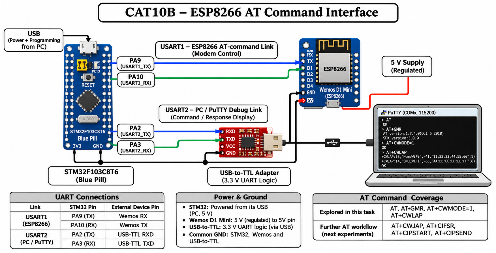

# CAT 10 — Task 10B: Explore ESP8266 AT Command Interface

## Experiment details

- **Course:** 25CS2741 — Fundamentals of Internet of Things + Lab
- **Assessment:** Continuous Lab Evaluation 10B
- **Date:** 05/10/2026
- **Experiment:** STM32-Wemos Wi-Fi Modem Interface Using AT Commands
- **Board:** STM32 Blue Pill (STM32F103C8T6)
- **Wi-Fi Module:** Wemos D1 Mini (ESP8266)
- **IDE / Framework:** STM32CubeMX, Keil MDK-ARM, STM32 HAL
- **Communication:** USART1 and USART2

## Aim

Explore the ESP8266 AT command interface using STM32 UART communication and investigate the modem's firmware information, Wi-Fi operating modes and available wireless networks.

## Hardware setup

| Component / Signal | Connection | Configuration |
|---|---|---|
| STM32 PA9 (USART1_TX) | Wemos RX | AT command transmission |
| STM32 PA10 (USART1_RX) | Wemos TX | Modem response reception |
| STM32 PA2 (USART2_TX) | USB-to-TTL RXD | PC terminal output |
| STM32 PA3 (USART2_RX) | USB-to-TTL TXD | PC terminal input |
| STM32 GND | Wemos GND | Common ground |
| Wemos USB connector | PC USB port | Wemos power supply |

USART1 communicates with the ESP8266, while USART2 provides the PC debugging interface through PuTTY.

## Circuit diagram

## Working principle

The STM32 communicates with the ESP8266 using AT commands through USART1 and forwards the modem responses to PuTTY through USART2.

The experiment investigates the following commands:

| AT Command | Purpose |
|---|---|
| `AT` | Verify modem communication |
| `AT+GMR` | Display firmware and SDK version |
| `AT+CWMODE=1` | Configure Wi-Fi station mode |
| `AT+CWLAP` | Scan for nearby Wi-Fi access points |

The `send_at_and_log()` function automates command transmission and response logging across the two UART interfaces.

## Core logic / pseudocode

1. Initialize HAL and configure the system clock.
2. Initialize USART1 for ESP8266 communication.
3. Initialize USART2 for PC terminal communication.
4. Send the `AT` command and verify the response.
5. Send `AT+GMR` to retrieve firmware information.
6. Send `AT+CWMODE=1` to configure station mode.
7. Send `AT+CWLAP` to scan nearby Wi-Fi networks.
8. Receive modem responses through USART1.
9. Forward the responses through USART2 to PuTTY.
10. Display and verify the returned information.

## HAL functions used

- `HAL_Init()` — Initialize the HAL library.
- `HAL_UART_Init()` — Initialize UART peripherals.
- `HAL_UART_Transmit()` — Send AT commands and forward responses.
- `HAL_UART_Receive()` — Receive ESP8266 responses.
- `HAL_GetTick()` — Obtain system tick information where required.

## Expected observation / result

- The `AT` command should return `OK`.
- `AT+GMR` should display the ESP8266 firmware information.
- `AT+CWMODE=1` should configure station mode.
- `AT+CWLAP` should return the list of nearby Wi-Fi access points.

## Inference

This experiment demonstrates the ESP8266 AT command interface through STM32 dual-UART communication. It establishes the basic modem-control workflow required for subsequent Wi-Fi connection, IP configuration and TCP communication experiments.

The explored command sequence provides the foundation for further operations such as `AT+CWJAP`, `AT+CIFSR`, `AT+CIPSTART` and `AT+CIPSEND`.

## Files

- `Core/Src/main.c` — AT command transmission and response handling.
- `Core/Inc/main.h` — Application and HAL declarations.
- `Blinky.ioc` — STM32CubeMX configuration.
- `MDK-ARM/Blinky.uvprojx` — Keil project.
- `MDK-ARM/startup_stm32f103xb.s` — Startup code.
- `circuit.png` — Hardware connection diagram.

## Safety and configuration checks

- Connect USART1 TX to Wemos RX and USART1 RX to Wemos TX.
- Connect USART2 TX to USB-to-TTL RX and USART2 RX to USB-to-TTL TX.
- Ensure UART signals use 3.3 V logic.
- Power the Wemos using its USB connector.
- Maintain common ground between the STM32, Wemos and USB-to-TTL converter.
- Verify that the ESP8266 AT firmware is responding before testing additional commands.
