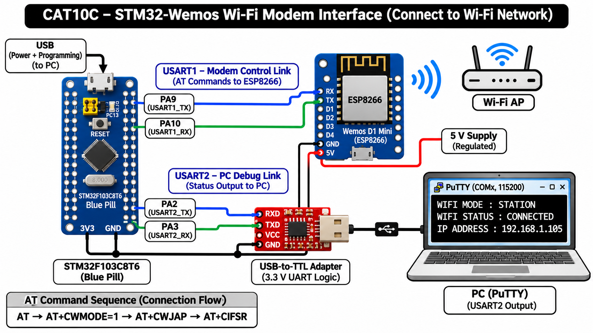

# CAT 10 — Task 10C: Connect Wemos ESP8266 to Wi-Fi Network

## Experiment details

- **Course:** 25CS2741 — Fundamentals of Internet of Things + Lab
- **Assessment:** Continuous Lab Evaluation 10C
- **Date:** 05/10/2026
- **Experiment:** STM32-Wemos Wi-Fi Modem Interface Using AT Commands
- **Board:** STM32 Blue Pill (STM32F103C8T6)
- **Wi-Fi Module:** Wemos D1 Mini (ESP8266)
- **IDE / Framework:** STM32CubeMX, Keil MDK-ARM, STM32 HAL
- **Communication:** USART1 and USART2

## Aim

Connect the Wemos D1 Mini ESP8266 to a Wi-Fi network using AT commands sent from the STM32 and retrieve its assigned IPv4 address.

## Hardware setup

| Component / Signal | Connection | Configuration |
|---|---|---|
| STM32 PA9 (USART1_TX) | Wemos RX | AT command transmission |
| STM32 PA10 (USART1_RX) | Wemos TX | Modem response reception |
| STM32 PA2 (USART2_TX) | USB-to-TTL RXD | PC terminal output |
| STM32 PA3 (USART2_RX) | USB-to-TTL TXD | PC terminal input |
| STM32 GND | Wemos GND | Common ground |
| Wemos USB connector | PC USB port | Wemos power supply |

USART1 handles communication with the ESP8266, while USART2 forwards debugging information to PuTTY. The Wemos is powered independently through its USB connection to the PC.

## Circuit diagram

## Working principle

The STM32 sends a sequence of AT commands to configure the ESP8266 in station mode, connect it to a Wi-Fi access point and retrieve its assigned IP address.

The command sequence is:

| AT Command | Purpose |
|---|---|
| `AT` | Verify modem communication |
| `AT+CWMODE=1` | Configure station mode |
| `AT+CWJAP` | Connect to the Wi-Fi access point |
| `AT+CIFSR` | Retrieve the assigned IP address |

The modem responses are received through USART1 and forwarded through USART2 to PuTTY.

The application reports the following information:

- `WIFI MODE : STATION`
- `WIFI STATUS : CONNECTED`
- DHCP-assigned IPv4 address

## Core logic / pseudocode

1. Initialize HAL and configure the system clock.
2. Initialize USART1 for ESP8266 communication.
3. Initialize USART2 for PC terminal communication.
4. Send `AT` to verify modem communication.
5. Send `AT+CWMODE=1` to configure station mode.
6. Send `AT+CWJAP` with the Wi-Fi credentials.
7. Wait for the connection response.
8. Send `AT+CIFSR` to retrieve the assigned IP address.
9. Forward modem responses through USART2.
10. Display connection status and IP address in PuTTY.

## HAL functions used

- `HAL_Init()` — Initialize the HAL library.
- `HAL_UART_Init()` — Initialize UART peripherals.
- `HAL_UART_Transmit()` — Transmit AT commands and modem responses.
- `HAL_UART_Receive()` — Receive ESP8266 responses.
- `HAL_GetTick()` — Obtain system tick information where required.

## Expected observation / result

- ESP8266 responds successfully to the `AT` command.
- Wi-Fi station mode is configured.
- The ESP8266 connects to the specified Wi-Fi network.
- The assigned IPv4 address is retrieved using `AT+CIFSR`.
- Connection status and IP address are displayed in PuTTY.

## Inference

This experiment demonstrates Wi-Fi network provisioning using the ESP8266 AT command interface controlled by an STM32 microcontroller. Successful connection and retrieval of the DHCP-assigned IP address establish the network communication required for subsequent TCP and HTTP server applications.

## Files

- `Core/Src/main.c` — Wi-Fi connection and AT command handling.
- `Core/Inc/main.h` — Application and HAL declarations.
- `Blinky.ioc` — STM32CubeMX configuration.
- `MDK-ARM/Blinky.uvprojx` — Keil project.
- `MDK-ARM/startup_stm32f103xb.s` — Startup code.
- `circuit.png` — Hardware connection diagram.

## Safety and configuration checks

- Connect USART1 TX to Wemos RX and USART1 RX to Wemos TX.
- Connect USART2 TX to USB-to-TTL RX and USART2 RX to USB-to-TTL TX.
- Ensure UART signals use 3.3 V logic.
- Power the Wemos through its USB connector.
- Maintain common ground between the STM32, Wemos and USB-to-TTL converter.
- Verify Wi-Fi SSID and password before executing `AT+CWJAP`.
