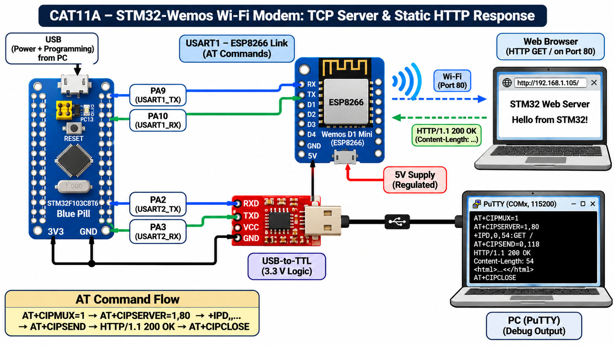

# CAT 11 — Task 11A: Configure ESP8266 TCP Server & Static HTTP Response

## Experiment details

- **Course:** 25CS2741 – Fundamentals of Internet of Things + Lab
- **Assessment:** Continuous Lab Evaluation 11A
- **Date:** 12/10/2026
- **Experiment:** HTTP Server – STM32-Wemos Wi-Fi Modem Using AT Commands
- **Board:** STM32 Blue Pill (STM32F103C8T6)
- **Wi-Fi Module:** Wemos D1 Mini (ESP8266)
- **IDE / Framework:** STM32CubeMX, Keil MDK-ARM, STM32 HAL
- **HTTP Client:** Web Browser

## Aim

Configure the ESP8266 as a TCP server using AT commands and serve a static HTML response to web browsers over a local Wi-Fi network.

## Hardware setup

| Component / Signal | Connection | Configuration |
|---|---|---|
| STM32 PA9 (USART1_TX) | Wemos RX | AT command transmission |
| STM32 PA10 (USART1_RX) | Wemos TX | Modem response reception |
| STM32 PA2 (USART2_TX) | PC terminal RX | Debug output |
| STM32 PA3 (USART2_RX) | PC terminal TX | Debug input |
| STM32 GND | Wemos GND | Common ground |
| Wemos USB connector | PC USB port | Power supply |
| Web Browser | ESP8266 IP address | HTTP client, port 80 |

USART1 handles ESP8266 communication, while USART2 provides PC debugging through PuTTY.

## Circuit diagram

## Working principle

The STM32 configures the ESP8266 as a multi-connection TCP server using the following AT commands:

- `AT+CIPMUX=1` – Enables multiple TCP connections.
- `AT+CIPSERVER=1,80` – Starts the TCP server on port 80.

When a browser sends an HTTP GET request, the ESP8266 forwards the request information to the STM32 through USART1 using the `+IPD` notification.

The STM32 processes the request, constructs an HTTP response containing an HTML page and calculates its exact `Content-Length`.

The response is transmitted using the two-step `AT+CIPSEND` procedure, followed by `AT+CIPCLOSE` to terminate the connection.

## Core logic / pseudocode

1. Initialize HAL, system clock and UART peripherals.
2. Configure USART1 for ESP8266 communication.
3. Configure USART2 for PC debugging.
4. Enable multiple connections using `AT+CIPMUX=1`.
5. Start the TCP server using `AT+CIPSERVER=1,80`.
6. Wait for incoming `+IPD` request notifications.
7. Extract the connection ID and process the HTTP GET request.
8. Construct an `HTTP/1.1 200 OK` response containing HTML content.
9. Calculate the response length using `strlen()`.
10. Send `AT+CIPSEND=<link_id>,<length>`.
11. Wait for the `>` prompt from the ESP8266.
12. Transmit the HTTP response.
13. Close the connection using `AT+CIPCLOSE`.
14. Continue listening for incoming requests.

## HAL functions used

- `HAL_Init()` — Initialize the HAL library.
- `HAL_UART_Init()` — Initialize UART peripherals.
- `HAL_UART_Transmit()` — Transmit AT commands and HTTP responses.
- `HAL_UART_Receive()` — Receive ESP8266 notifications and responses.
- `strlen()` — Calculate the HTTP response length.
- `HAL_GetTick()` — Obtain system tick information where required.

## Expected observation / result

- ESP8266 successfully starts a TCP server on port 80.
- The browser sends an HTTP GET request.
- STM32 receives the request through the ESP8266.
- The STM32 generates and transmits a valid HTTP response.
- The browser displays the returned static HTML page.

## Inference

This experiment demonstrates the implementation of a lightweight embedded HTTP server using STM32 and ESP8266 AT commands.

The multi-connection TCP configuration and two-step `AT+CIPSEND` procedure enable the STM32 to process browser requests and serve valid HTML responses over a local Wi-Fi network.

## Files

- `Core/Src/main.c` — TCP server configuration and HTTP request handling.
- `Core/Inc/main.h` — Application and HAL declarations.
- `Blinky.ioc` — STM32CubeMX configuration.
- `MDK-ARM/Blinky.uvprojx` — Keil project.
- `MDK-ARM/startup_stm32f103xb.s` — Startup code.
- `circuit.png` — Hardware connection diagram.

## Safety and configuration checks

- Connect USART1 TX to Wemos RX and USART1 RX to Wemos TX.
- Connect USART2 to the PC debugging interface.
- Ensure UART signals use 3.3 V logic.
- Power the Wemos through its USB connector.
- Maintain common ground between the STM32 and Wemos.
- Ensure the browser and ESP8266 are connected to the same Wi-Fi network.
- Verify the ESP8266 IP address and use port 80.
