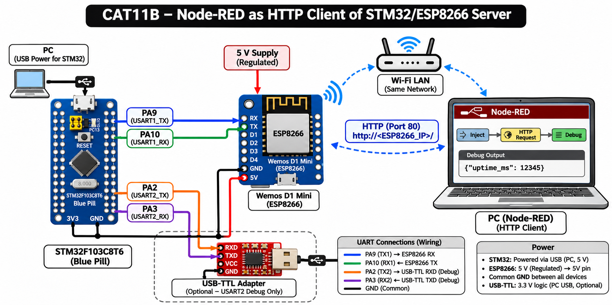

# CAT 11 — Task 11B: Node-RED as HTTP Client of STM32/ESP8266 Server

## Experiment details

- **Course:** 25CS2741 – Fundamentals of Internet of Things + Lab
- **Assessment:** Continuous Lab Evaluation 11B
- **Date:** 12/10/2026
- **Experiment:** HTTP Server – STM32-Wemos Wi-Fi Modem Using AT Commands
- **Board:** STM32 Blue Pill (STM32F103C8T6)
- **Wi-Fi Module:** Wemos D1 Mini (ESP8266)
- **IDE / Framework:** STM32CubeMX, Keil MDK-ARM, STM32 HAL
- **Integration Platform:** Node-RED

## Aim

Establish HTTP communication between an STM32-based ESP8266 web server and Node-RED to retrieve dynamic sensor-independent uptime telemetry in JSON format.

## Hardware setup

| Component / Signal | Connection | Configuration |
|---|---|---|
| STM32 PA9 (USART1_TX) | Wemos RX | AT command transmission |
| STM32 PA10 (USART1_RX) | Wemos TX | Modem response reception |
| STM32 PA2 (USART2_TX) | PC communication interface | Debug output |
| STM32 PA3 (USART2_RX) | PC communication interface | Debug input |
| STM32 GND | Wemos GND | Common ground |
| Wemos USB connector | PC USB port | Power supply |
| Node-RED | HTTP endpoint on ESP8266 | HTTP client, port 80 |

USART1 handles ESP8266 communication, while USART2 provides the PC debugging interface.

## Circuit diagram

## Working principle

The STM32 configures the ESP8266 as an HTTP server on port 80. Unlike the previous task, which serves static HTML content, this task generates dynamic JSON telemetry containing the STM32 uptime obtained through `HAL_GetTick()`.

When Node-RED sends an HTTP GET request, the ESP8266 forwards the request to the STM32 through UART.

The STM32 constructs a JSON payload and calculates its exact length using `strlen()`. It then sends an HTTP response with:

- `Content-Type: application/json`
- Correct `Content-Length`
- Dynamic uptime information

Node-RED retrieves the response using an HTTP Request node and displays the received data through a Debug node.

## Core logic / pseudocode

1. Initialize HAL, system clock and UART peripherals.
2. Configure USART1 for ESP8266 communication.
3. Configure USART2 for PC debugging.
4. Start the ESP8266 TCP server on port 80.
5. Wait for incoming HTTP GET requests through `+IPD` notifications.
6. Read the current STM32 uptime using `HAL_GetTick()`.
7. Construct a dynamic JSON payload.
8. Calculate the JSON response length using `strlen()`.
9. Construct the HTTP response with the appropriate headers.
10. Transmit the response using the ESP8266 `AT+CIPSEND` command.
11. Close the TCP connection after transmission.
12. Import `node_red_flow.json` into Node-RED.
13. Configure the HTTP Request node with `http://<ESP8266_IP>/`.
14. Display the received JSON response using the Debug node.

## Node-RED flow

The experiment uses the following Node-RED pipeline:

**Inject → HTTP Request → Debug**

| Node | Function |
|---|---|
| Inject | Triggers an HTTP request |
| HTTP Request | Retrieves JSON data from the ESP8266 server |
| Debug | Displays the received response |

The endpoint is:

`http://<ESP8266_IP>/`

## HAL functions used

- `HAL_Init()` — Initialize the HAL library.
- `HAL_UART_Init()` — Initialize UART peripherals.
- `HAL_UART_Transmit()` — Transmit AT commands and HTTP responses.
- `HAL_UART_Receive()` — Receive ESP8266 request notifications.
- `HAL_GetTick()` — Retrieve the STM32 uptime in milliseconds.
- `strlen()` — Calculate the JSON payload length.

## Expected observation / result

- ESP8266 successfully operates as an HTTP server on port 80.
- Node-RED sends HTTP GET requests to the ESP8266 IP address.
- STM32 generates dynamic JSON uptime telemetry.
- Node-RED receives the HTTP response successfully.
- The Debug node displays the received JSON data.

## Inference

This experiment demonstrates the integration of Node-RED with an embedded HTTP server using STM32 and ESP8266.

Dynamic JSON responses allow Node-RED to retrieve continuously updated telemetry through HTTP requests. This establishes the foundation for automated data collection, visualization and dashboard integration.

## Files

- `Core/Src/main.c` — HTTP server and JSON response handling.
- `Core/Inc/main.h` — Application and HAL declarations.
- `Blinky.ioc` — STM32CubeMX configuration.
- `MDK-ARM/Blinky.uvprojx` — Keil project.
- `MDK-ARM/startup_stm32f103xb.s` — Startup code.
- `node_red_flow.json` — Importable Node-RED flow.
- `circuit.png` — Hardware connection diagram.

## Safety and configuration checks

- Connect USART1 TX to Wemos RX and USART1 RX to Wemos TX.
- Ensure UART signals use 3.3 V logic.
- Power the Wemos through its USB connection.
- Maintain common ground between the STM32 and Wemos.
- Ensure Node-RED and the ESP8266 server are reachable over the same network.
- Verify the ESP8266 IP address before configuring the HTTP Request node.
- Ensure the HTTP response contains the correct `Content-Length`.
