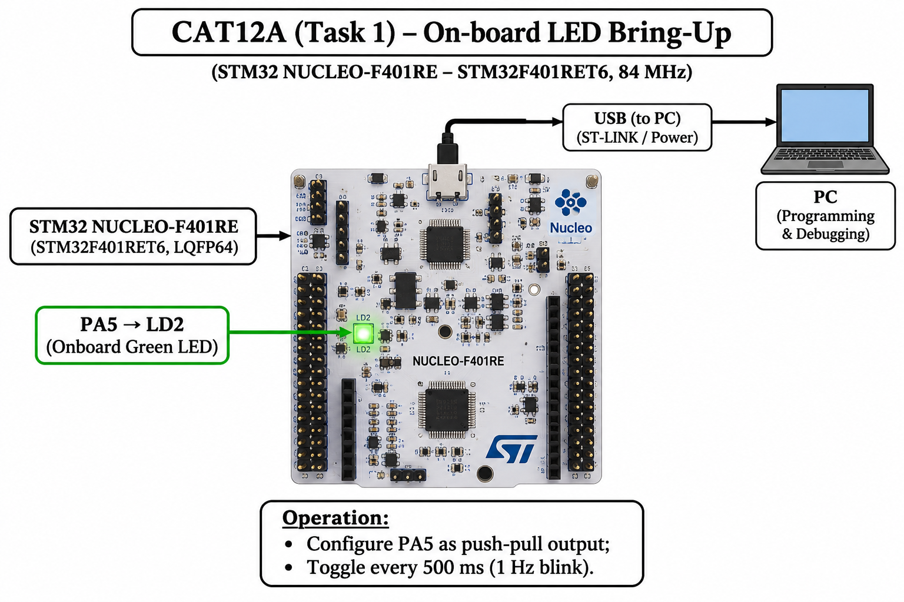

# CAT 12 — Task 12A: On-board LED Bring-Up

## Experiment details

- **Course:** 25CS2741 – Fundamentals of Internet of Things + Lab
- **Assessment:** Continuous Assessment 12A
- **Date:** 14/10/2026
- **Experiment:** STM32F401RE Cortex-M4 – GPIO and User Input Programming
- **Board:** STM32 Nucleo-F401RE (STM32F401RET6)
- **IDE / Framework:** STM32CubeMX, Keil MDK-ARM, STM32 HAL
- **System Clock:** 84 MHz

## Aim

Configure the onboard green LED of the STM32 Nucleo-F401RE as a GPIO output and implement periodic LED toggling to verify basic GPIO functionality.

## Hardware setup

| Component / Signal | Connection | Configuration |
|---|---|---|
| Onboard LED LD2 | PA5 | GPIO push-pull output |
| Board Power | USB connection | Powered through ST-LINK |
| Programming Interface | ST-LINK | USB programming and debugging |

The onboard green LED LD2 is connected to PA5 and operates with active-high logic. No external LED or additional wiring is required.

## Circuit diagram

## Working principle

The STM32 HAL initializes the microcontroller and configures the system clock to 84 MHz.

GPIO pin PA5 is configured as a push-pull output to control the onboard green LED LD2.

The main loop continuously toggles the output state of PA5 using `HAL_GPIO_TogglePin()` with a 500 ms delay using `HAL_Delay()`.

This produces a continuous blinking pattern with a complete ON-OFF cycle every second.

## Core logic / pseudocode

1. Initialize the STM32 HAL library.
2. Configure the system clock to 84 MHz.
3. Initialize GPIOA.
4. Configure PA5 as a push-pull output.
5. Enter the infinite loop.
6. Toggle PA5 using `HAL_GPIO_TogglePin()`.
7. Introduce a 500 ms delay using `HAL_Delay(500)`.
8. Repeat continuously.

## HAL functions used

- `HAL_Init()` — Initialize the STM32 HAL library.
- `HAL_GPIO_Init()` — Configure GPIO pin PA5.
- `HAL_GPIO_TogglePin()` — Toggle the onboard LED.
- `HAL_Delay()` — Generate a 500 ms delay.
- `HAL_RCC_OscConfig()` — Configure the system oscillator.
- `HAL_RCC_ClockConfig()` — Configure the system clock.

## Expected observation / result

- The onboard green LED LD2 should turn ON.
- After 500 ms, the LED should turn OFF.
- The LED should continue blinking at a steady rate.
- One complete ON-OFF cycle should take approximately one second.

## Inference

This experiment demonstrates basic GPIO output configuration and control using STM32 HAL on the Cortex-M4 microcontroller.

Successful blinking of LD2 verifies the GPIO configuration, system clock setup
