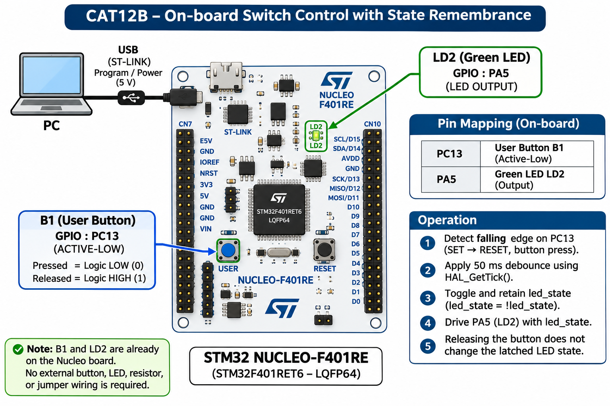

# CAT 12 — Task 12B: On-board Switch Control with State Remembrance

## Experiment details

- **Course:** 25CS2741 – Fundamentals of Internet of Things + Lab
- **Assessment:** Continuous Assessment 12B
- **Date:** 14/10/2026
- **Experiment:** STM32F401RE Cortex-M4 – GPIO and User Input Programming
- **Board:** STM32 Nucleo-F401RE
- **IDE / Framework:** STM32CubeMX, Keil MDK-ARM, STM32 HAL

## Aim

Interface the onboard user button with the onboard LED and implement state remembrance so that each valid button press toggles the LED state, which remains unchanged after releasing the button.

## Hardware setup

| Component / Signal | Connection | Configuration |
|---|---|---|
| Onboard User Button B1 | PC13 | GPIO Input, Active-Low |
| Onboard LED LD2 | PA5 | GPIO Push-Pull Output |
| Board Power | USB connection | Powered through ST-LINK |

Both the user button and LED are available directly on the Nucleo-F401RE board. No external components or additional wiring are required.

## Circuit diagram

## Working principle

The firmware continuously monitors the onboard user button B1 connected to PC13.

Since the button is active-low, pressing it produces a falling edge (`SET → RESET`). The program detects this transition and applies a 50 ms debounce interval using `HAL_GetTick()`.

After a valid press is detected, the `led_state` variable is inverted and the corresponding output is written to PA5.

The LED retains its toggled state even after the button is released.

## Core logic / pseudocode

1. Initialize HAL and configure the system clock.
2. Configure PC13 as a GPIO input.
3. Configure PA5 as a push-pull output.
4. Initialize `led_state` and `prev_btn`.
5. Continuously read the button state on PC13.
6. Detect a falling edge (`SET → RESET`).
7. Apply a 50 ms debounce filter using `HAL_GetTick()`.
8. If the press is valid, invert `led_state`.
9. Update PA5 according to the stored LED state.
10. Retain the LED state after button release.
11. Repeat continuously.

## HAL functions used

- `HAL_Init()` — Initialize the STM32 HAL library.
- `HAL_GPIO_Init()` — Configure GPIO pins.
- `HAL_GPIO_ReadPin()` — Read the user button state.
- `HAL_GPIO_WritePin()` — Update the LED output.
- `HAL_GetTick()` — Measure debounce timing.
- `HAL_RCC_OscConfig()` — Configure the system oscillator.
- `HAL_RCC_ClockConfig()` — Configure the system clock.

## Expected observation / result

| User Action | Expected Result |
|---|---|
| Press B1 once | LED toggles ON or OFF |
| Release B1 | LED retains its current state |
| Press B1 again | LED toggles to the opposite state |
| Button contact bounce | Multiple unwanted toggles are prevented |

## Inference

This experiment demonstrates state-based GPIO control and software debouncing using STM32 HAL.

The `led_state` variable maintains the LED's previous state, while falling-edge detection and a 50 ms debounce interval ensure that each valid button press produces exactly one toggle.

## Files

- `Core/Src/main.c` — Button detection, debounce and LED state logic.
- `Core/Inc/main.h` — Application and HAL declarations.
- `*.ioc` — STM32CubeMX configuration.
- `MDK-ARM/*.uvprojx` — Keil project file.
- `circuit.png` — Board connection diagram.

## Safety and configuration checks

- Configure PC13 as an active-low button input.
- Configure PA5 as a push-pull output.
- Use the onboard B1 button and LD2 LED.
- Ensure the board is powered through USB.
- Verify the 50 ms debounce implementation.
- No external power supply or additional wiring is required.
