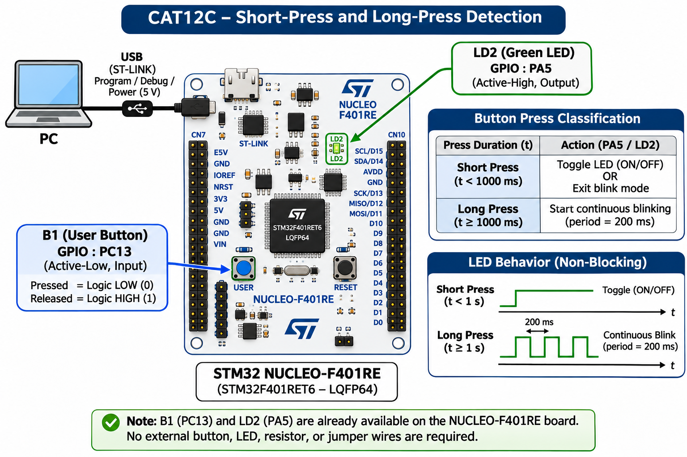

# CAT 12 — Task 12C: Short-Press and Long-Press Detection

## Experiment details

- **Course:** 25CS2741 – Fundamentals of Internet of Things + Lab
- **Assessment:** Continuous Assessment 12C
- **Date:** 14/10/2026
- **Experiment:** STM32F401RE Cortex-M4 – GPIO and User Input Programming
- **Board:** STM32 Nucleo-F401RE
- **IDE / Framework:** STM32CubeMX, Keil MDK-ARM, STM32 HAL

## Aim

Implement short-press and long-press detection using the onboard user button. A short press toggles the LED, while a long press activates continuous LED blinking.

## Hardware setup

| Component / Signal | Connection | Configuration |
|---|---|---|
| Onboard User Button B1 | PC13 | GPIO Input, Active-Low |
| Onboard LED LD2 | PA5 | GPIO Push-Pull Output |
| Board Power | USB connection | Powered through ST-LINK |

No external components or additional wiring are required.

## Circuit diagram

## Working principle

The firmware monitors the onboard button connected to PC13 and measures the button press duration using `HAL_GetTick()`.

- **Short press (< 1000 ms):** Toggles the LED state.
- **Long press (≥ 1000 ms):** Activates continuous LED blinking.
- **Short press during blinking:** Stops blinking and toggles the LED state.
- **Long press again:** Re-enters continuous blinking mode.

A non-blocking approach is used to detect press duration and control LED blinking without stopping the main program execution.

## Core logic / pseudocode

1. Initialize HAL and configure the system clock.
2. Configure PC13 as GPIO input.
3. Configure PA5 as GPIO push-pull output.
4. Continuously monitor the button state.
5. Detect button press and record the start time using `HAL_GetTick()`.
6. Detect button release and calculate the press duration.
7. If duration is less than 1000 ms:
   - Toggle the LED state.
   - If blinking mode is active, stop blinking.
8. If duration is 1000 ms or greater:
   - Activate continuous blinking mode.
9. While blinking mode is active, toggle the LED every 200 ms.
10. Repeat continuously.

## HAL functions used

- `HAL_Init()` — Initialize the STM32 HAL library.
- `HAL_GPIO_Init()` — Configure GPIO pins.
- `HAL_GPIO_ReadPin()` — Read the button state.
- `HAL_GPIO_WritePin()` — Control the LED.
- `HAL_GPIO_TogglePin()` — Toggle the LED output.
- `HAL_GetTick()` — Measure press duration and blinking intervals.
- `HAL_RCC_OscConfig()` — Configure the system oscillator.
- `HAL_RCC_ClockConfig()` — Configure the system clock.

## Expected observation / result

| Button Action | Expected Result |
|---|---|
| Short press (< 1 second) | LED toggles ON/OFF |
| Long press (≥ 1 second) | LED enters continuous blinking mode |
| Short press during blinking | Blinking stops |
| Long press again | Blinking mode activates again |

## Inference

This experiment demonstrates button press-duration measurement and event-based GPIO control using STM32 HAL.

By using `HAL_GetTick()`, the firmware distinguishes short and long presses without relying on blocking delays. The LED operates according to the detected input event.

## Files

- `Core/Src/main.c` — Button detection, timing and LED control logic.
- `Core/Inc/main.h` — Application and HAL declarations.
- `*.ioc` — STM32CubeMX configuration.
- `MDK-ARM/*.uvprojx` — Keil project file.
- `circuit.png` — Board connection diagram.

## Safety and configuration checks

- Configure PC13 as an active-low button input.
- Configure PA5 as a push-pull output.
- Use the onboard B1 button and LD2 LED.
- Ensure the board is powered through USB.
- Verify the 1000 ms press-duration threshold.
- Verify the 200 ms blinking interval.
- No external power supply or additional wiring is required.
