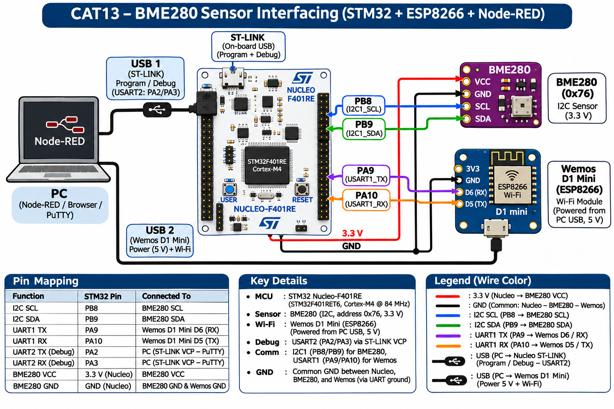

# CAT 13 — Sensor Interfacing (BME280) – STM32 Debug – ESP8266 Wi-Fi HTTP – Node-RED Analytics

## Experiment details

- **Course:** Fundamentals of Internet of Things + Lab
- **Assessment:** Continuous Assessment 13
- **Date:** 23/10/2026
- **Experiment:** Sensor Interfacing using BME280, STM32 and ESP8266
- **Microcontroller:** STM32 NUCLEO-F401RE
- **Sensor:** BME280 Temperature, Pressure and Humidity Sensor
- **Wi-Fi Module:** ESP8266
- **Development Tools:** STM32CubeMX, Keil MDK-ARM
- **Dashboard:** Node-RED

## Aim

Interface the BME280 sensor with the STM32 Nucleo-F401RE using I2C, retrieve temperature, pressure and humidity readings, and transmit the sensor data through an ESP8266 HTTP server for browser access and Node-RED analytics.

## Hardware requirements

- STM32 NUCLEO-F401RE development board
- BME280 I2C sensor module
- ESP8266 Wi-Fi module
- USB cables for powering the Nucleo board and ESP8266
- Computer with STM32CubeMX, Keil MDK-ARM and Node-RED

## Hardware connections

| Component | Pin | STM32 Connection |
|---|---|---|
| BME280 | VCC | 3.3V |
| BME280 | GND | GND |
| BME280 | SCL | PB8 (I2C1 SCL) |
| BME280 | SDA | PB9 (I2C1 SDA) |
| ESP8266 | RX | PA9 (USART1 TX) |
| ESP8266 | TX | PA10 (USART1 RX) |
| ESP8266 | GND | Common GND |

**Debug communication:**
- USART2 PA2 (TX) and PA3 (RX) are used for debugging through the Nucleo board's ST-LINK Virtual COM Port.
- The Nucleo board is powered through its USB connection to the PC.
- The ESP8266 is powered separately through its own USB connection to the PC.
- The BME280 is powered using the Nucleo board's 3.3V supply.
- Ensure a common ground between the Nucleo board, BME280 and ESP8266.

## Circuit diagram

## Working principle

1. The STM32 communicates with the BME280 sensor through I2C1.
2. The sensor is initialized using the Bosch BME280 Sensor API.
3. Temperature, pressure and humidity values are read periodically.
4. The sensor readings are compensated using the sensor calibration data.
5. The STM32 formats the readings into JSON data.
6. The JSON data is transmitted to the ESP8266 through USART1.
7. The ESP8266 hosts an HTTP server and responds to incoming browser requests.
8. Node-RED accesses the HTTP endpoint and processes the sensor readings.
9. Node-RED displays minimum, maximum and average sensor values.

## Software implementation

### BME280 sensor interfacing

- Uses the official Bosch Sensor API.
- Files used:
  - `bme280.c`
  - `bme280.h`
  - `bme280_defs.h`
- HAL I2C communication functions:
  - `user_i2c_read()`
  - `user_i2c_write()`
  - `user_delay_us()`
- Sensor configuration:
  - I2C address: `0x76`
  - Temperature oversampling: 1x
  - Pressure oversampling: 1x
  - Humidity oversampling: 1x
  - Operating mode: Normal mode
- Sensor readings are collected at one-second intervals.

### ESP8266 HTTP communication

- STM32 communicates with the ESP8266 using USART1.
- ESP8266 AT commands are used to configure Wi-Fi and HTTP server functionality.
- Sensor readings are formatted as JSON.
- HTTP responses include the appropriate `Content-Type` and `Content-Length` headers.

### Node-RED analytics

The Node-RED flow retrieves sensor data from the ESP8266 HTTP endpoint.

**Flow:**

`HTTP Request → JSON Processing → Dashboard / Debug`

Node-RED processes the received readings and calculates:
- Minimum temperature, pressure and humidity.
- Maximum temperature, pressure and humidity.
- Average temperature, pressure and humidity.

## Core logic / pseudocode

1. Initialize HAL and configure the system clock.
2. Initialize I2C1, USART1 and USART2.
3. Initialize the BME280 sensor using the Bosch API.
4. Configure the ESP8266 using AT commands.
5. Connect the ESP8266 to the Wi-Fi network.
6. Start the HTTP server.
7. Read temperature, pressure and humidity from BME280.
8. Format the sensor readings into JSON.
9. Transmit the JSON data to the ESP8266.
10. Respond to HTTP requests with the latest sensor readings.
11. Allow Node-RED to retrieve and analyze the data.
12. Repeat sensor acquisition every second.

## Expected observation / result

- BME280 successfully communicates with STM32 through I2C.
- Temperature, pressure and humidity readings are displayed through the USART2 debug interface.
- ESP8266 establishes a Wi-Fi connection.
- Browser requests receive sensor readings in JSON format.
- Node-RED retrieves the readings and displays minimum, maximum and average values.

## Inference

The experiment demonstrates sensor interfacing using I2C, UART-based communication between STM32 and ESP8266, and HTTP-based IoT data transfer.

The integration of Node-RED enables real-time retrieval and analysis of environmental sensor readings.

## Files

- `Core/Src/main.c` — Main application logic.
- `Core/Inc/main.h` — Application declarations.
- `bme280.c` — Bosch BME280 sensor implementation.
- `bme280.h` — BME280 API declarations.
- `bme280_defs.h` — Sensor register and configuration definitions.
- `*.ioc` — STM32CubeMX configuration.
- `MDK-ARM/*.uvprojx` — Keil project file.
- `node_red_flow.json` — Node-RED flow configuration.
- `circuit.png` — Hardware connection diagram.

## Safety and configuration checks

- Use 3.3V logic for the BME280 and ESP8266.
- Verify the BME280 I2C address is `0x76`.
- Cross-connect USART1 TX and RX correctly.
- Ensure common ground between all connected modules.
- Power the Nucleo board and ESP8266 through their separate USB connections.
- Verify the ESP8266 Wi-Fi connection before testing HTTP requests.
- Ensure the Node-RED endpoint uses the correct ESP8266 IP address.
