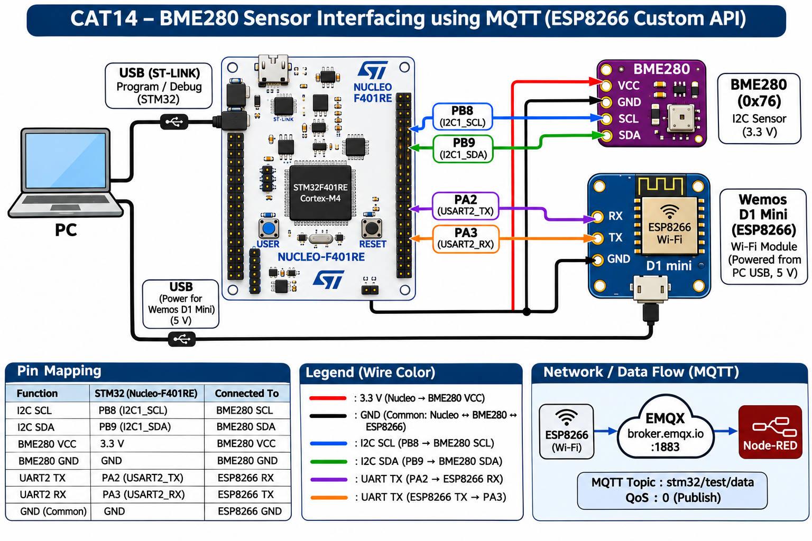

# CAT 14 — Sensor Interfacing (BME280) – MQTT – Node-RED Analytics

## Experiment details

- **Course:** Fundamentals of Internet of Things + Lab
- **Assessment:** Continuous Assessment 14
- **Date:** 27/10/2026
- **Experiment:** Sensor Interfacing using BME280, STM32 and MQTT
- **Microcontroller:** STM32 NUCLEO-F401RE
- **Sensor:** BME280 Temperature, Pressure and Humidity Sensor
- **Wi-Fi Module:** ESP8266
- **MQTT Broker:** broker.emqx.io
- **Development Tools:** STM32CubeMX, Keil MDK-ARM
- **Dashboard:** Node-RED

## Aim

Interface the BME280 sensor with the STM32 Nucleo-F401RE using I2C and transmit temperature, pressure and humidity readings to an MQTT broker through the ESP8266. Use Node-RED to subscribe to the published MQTT topic and receive sensor data.

## Hardware requirements

- STM32 NUCLEO-F401RE development board
- BME280 I2C sensor module
- ESP8266 Wi-Fi module (Wemos D1 Mini)
- USB cables for powering the development board and ESP8266
- Computer with STM32CubeMX, Keil MDK-ARM and Node-RED

## Hardware connections

| Component | Pin | STM32 Connection |
|---|---|---|
| BME280 | VCC | 3.3V |
| BME280 | GND | GND |
| BME280 | SCL | PB8 (I2C1 SCL) |
| BME280 | SDA | PB9 (I2C1 SDA) |
| ESP8266 | RX | PA2 (USART2 TX) |
| ESP8266 | TX | PA3 (USART2 RX) |
| ESP8266 | GND | Common GND |

**Power and communication setup:**
- Nucleo-F401RE is powered through its USB connection to the PC.
- ESP8266 is powered separately through its own USB connection to the PC.
- BME280 receives 3.3V from the Nucleo board.
- USART2 PA2/PA3 handles UART communication between STM32 and ESP8266.
- Ensure a common ground between the connected modules.

## Circuit diagram

## Working principle

1. STM32 initializes the BME280 sensor through I2C1.
2. The sensor provides temperature, pressure and humidity readings.
3. STM32 reads and compensates the sensor data.
4. The readings are formatted into a JSON payload.
5. STM32 communicates with the ESP8266 using USART2.
6. ESP8266 connects to the Wi-Fi network using AT commands.
7. The ESP8266 establishes a connection to the MQTT broker `broker.emqx.io` on port `1883`.
8. STM32 publishes the JSON sensor data using MQTT QoS 0.
9. The data is published to the topic `stm32/test/data`.
10. Node-RED subscribes to the same topic and receives the sensor readings.

## Software implementation

### BME280 sensor interfacing

- BME280 communicates with STM32 through I2C1.
- I2C pins:
  - PB8 – SCL
  - PB9 – SDA
- Sensor I2C address: `0x76`.
- Temperature, pressure and humidity readings are acquired and compensated using the sensor data.

### ESP8266 communication

A custom ESP8266 library, `ESPLib`, is used to handle communication through AT commands.

Important functions include:

- `ESP8266_Init()` — Initialize ESP8266 communication.
- `ESP8266_wifiConnect()` — Connect to the Wi-Fi network.
- `ESP8266_portConnect()` — Establish the broker connection.

### MQTT implementation

The custom `ESPLib` implements MQTT 3.1.1 packet handling.

Important functions include:

- `MQTT_connectBroker()` — Establish an MQTT connection.
- `MQTT_publishTopic()` — Publish sensor data to an MQTT topic.
- `MQTTTimer()` — Maintain MQTT timing operations.

**MQTT configuration:**

| Parameter | Value |
|---|---|
| Broker | `broker.emqx.io` |
| Port | `1883` |
| Protocol | MQTT 3.1.1 |
| QoS | 0 |
| Topic | `stm32/test/data` |
| Payload | JSON sensor readings |

The `SysTick_Handler()` invokes `MQTTTimer()` every 1 ms to maintain MQTT timing.

### Node-RED integration

Node-RED uses an MQTT-in node to subscribe to the sensor topic.

**Flow:**

`MQTT Broker → MQTT In → JSON Processing → Debug / Dashboard`

- Configure the broker as `broker.emqx.io`.
- Set the port to `1883`.
- Subscribe to `stm32/test/data`.
- Receive and process the published JSON payload.

## Core logic / pseudocode

1. Initialize HAL and configure the system clock.
2. Initialize I2C1 and USART2.
3. Initialize the BME280 sensor.
4. Initialize the ESP8266 using `ESP8266_Init()`.
5. Connect ESP8266 to Wi-Fi using `ESP8266_wifiConnect()`.
6. Connect to the MQTT broker using `MQTT_connectBroker()`.
7. Read temperature, pressure and humidity from BME280.
8. Format the readings into JSON.
9. Publish the JSON payload using `MQTT_publishTopic()`.
10. Maintain MQTT timing through `MQTTTimer()` called every 1 ms.
11. Receive the published data in Node-RED through the MQTT-in node.
12. Repeat sensor acquisition and publishing.

## Expected observation / result

- BME280 successfully communicates with STM32 through I2C.
- Temperature, pressure and humidity readings are acquired.
- ESP8266 successfully connects to the Wi-Fi network.
- STM32 establishes an MQTT connection through ESP8266.
- JSON sensor readings are published to `stm32/test/data`.
- Node-RED receives the published sensor data through its MQTT-in node.

## Inference

This experiment demonstrates environmental sensor interfacing, UART-based ESP8266 communication and MQTT-based IoT data transmission.

The integration of STM32, BME280, ESP8266 and Node-RED demonstrates how sensor data can be acquired, published to a remote MQTT broker and received by an IoT dashboard.

## Files

- `Core/Src/main.c` — Main application logic.
- `Core/Inc/main.h` — Application declarations.
- `ESPLib.c` — ESP8266 communication and MQTT implementation.
- `ESPLib.h` — ESP8266 and MQTT function declarations.
- `bme280.c` — BME280 sensor implementation.
- `bme280.h` — BME280 API declarations.
- `bme280_defs.h` — Sensor register and configuration definitions.
- `*.ioc` — STM32CubeMX configuration.
- `MDK-ARM/*.uvprojx` — Keil project file.
- `circuit.png` — Hardware connection diagram.

## Safety and configuration checks

- Use 3.3V-compatible logic for the BME280 and ESP8266.
- Verify the BME280 I2C address is `0x76`.
- Cross-connect USART2 TX and RX correctly.
- Ensure common ground between STM32, BME280 and ESP8266.
- Power the Nucleo board and ESP8266 through their separate USB connections.
- Verify Wi-Fi connectivity before testing MQTT.
- Ensure Node-RED subscribes to the exact topic `stm32/test/data`.
- Confirm the MQTT broker address and port are correct.
- 
