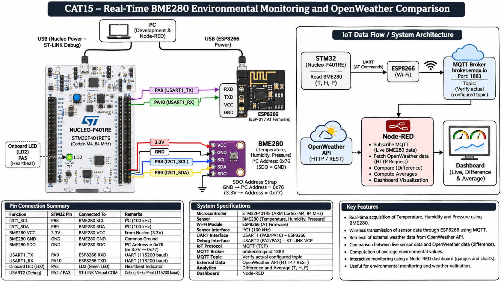
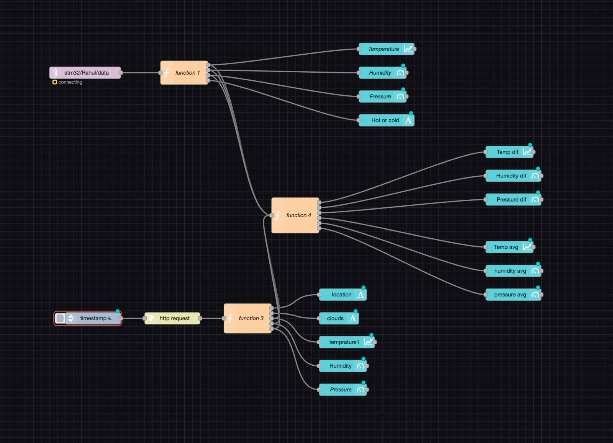
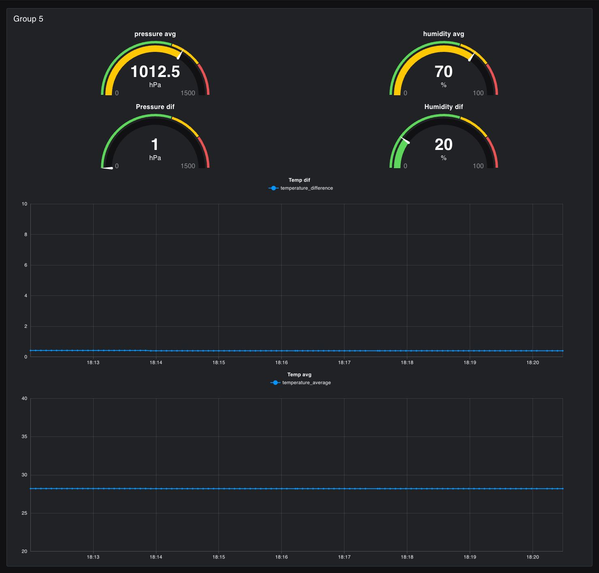

# CAT15 — Real-Time Environmental Monitoring, OpenWeather Comparison and Node-RED Analytics

## 1. Experiment Details

- **Course:** 25CS2741 – Foundations of Internet of Things + Lab
- **Experiment:** Real-Time BME280 Environmental Sensing and OpenWeather Data Comparison
- **Hardware:** STM32 Nucleo-F401RE, BME280 and ESP8266
- **Microcontroller:** STM32F401RET6 – ARM Cortex-M4
- **Development Tools:** STM32CubeMX and Keil MDK-ARM
- **Sensor Communication:** I2C1
- **Wireless Communication:** ESP8266 using UART
- **IoT Protocol:** MQTT
- **MQTT Broker:** `broker.emqx.io:1883`
- **Cloud Weather Data:** OpenWeather API
- **Dashboard and Analytics:** Node-RED

## 2. Aim

To develop a real-time environmental monitoring system using the BME280 sensor and STM32 Nucleo-F401RE.

The system transmits live temperature, humidity and atmospheric pressure readings through an ESP8266 module using MQTT. Node-RED retrieves these readings and compares them with external weather information obtained from the OpenWeather API.

The dashboard displays live sensor values, weather information, differences between the two data sources, average readings and environmental conditions.

## 3. Hardware Requirements

- STM32 NUCLEO-F401RE development board
- BME280 temperature, humidity and pressure sensor
- ESP8266 Wi-Fi module
- USB cables for the Nucleo board and ESP8266
- Computer with STM32CubeMX, Keil MDK-ARM and Node-RED

## 4. Hardware Connections

| Peripheral / Signal | STM32 Pin | Connection |
|---|---|---|
| BME280 SCL | PB8 | I2C1 Clock |
| BME280 SDA | PB9 | I2C1 Data |
| BME280 VCC | 3.3V | Power supply |
| BME280 GND | GND | Common ground |
| ESP8266 RX | PA9 | USART1 TX |
| ESP8266 TX | PA10 | USART1 RX |
| ESP8266 GND | GND | Common ground |
| Debug USART2 TX | PA2 | ST-LINK Virtual COM |
| Debug USART2 RX | PA3 | ST-LINK Virtual COM |
| Onboard LED | PA5 | LD2 heartbeat indicator |

### Power Configuration

- STM32 Nucleo-F401RE is powered through its USB connection to the PC.
- ESP8266 is powered through its own USB connection to the PC.
- BME280 receives 3.3V from the Nucleo board.
- Common ground is maintained between the connected modules.
- USART2 is used for debugging through the Nucleo board's ST-LINK Virtual COM interface.

## 5. Circuit Diagram



## 6. System Architecture

The project uses two independent sources of environmental information.

### A. Live Sensor Data

1. BME280 measures temperature, relative humidity and atmospheric pressure.
2. STM32 reads the sensor measurements through I2C1.
3. The sensor readings are formatted into JSON.
4. ESP8266 connects to the Wi-Fi network.
5. STM32 sends the readings through ESP8266 to the MQTT broker.
6. Node-RED receives the live measurements through an MQTT input node.

### B. OpenWeather Data

1. Node-RED periodically triggers an HTTP request.
2. The request retrieves weather information from the OpenWeather API.
3. The response contains weather information such as:
   - Location
   - Cloud conditions
   - Temperature
   - Humidity
   - Atmospheric pressure
4. A function node processes the response and extracts the required values.

### C. Data Comparison and Analytics

Node-RED processes both data sources to calculate:

- Temperature difference
- Humidity difference
- Pressure difference
- Average temperature
- Average humidity
- Average atmospheric pressure

The processed values are forwarded to dashboard widgets for visualization.

## 7. Node-RED Flow Architecture

The Node-RED flow consists of three major processing sections.

### Function 1 – Live Sensor Processing

- Receives BME280 measurements through the MQTT input node.
- Extracts temperature, humidity and pressure.
- Updates the corresponding dashboard widgets.
- Determines whether the measured temperature is hot or cold.

### Function 3 – OpenWeather Processing

- Receives weather information through an HTTP request node.
- Extracts location and cloud information.
- Processes temperature, humidity and pressure.
- Sends the extracted values to dashboard widgets and comparison logic.

### Function 4 – Comparison and Statistical Processing

- Receives live sensor and OpenWeather measurements.
- Calculates the differences between corresponding parameters.
- Calculates average temperature, humidity and pressure.
- Sends the results to dashboard gauges and charts.

### Overall Flow

```text
             LIVE SENSOR DATA
                    |
             MQTT Input Node
                    |
                 Function 1
                    |
          +---------+----------+
          |         |          |
      Temperature Humidity  Pressure
          |         |          |
          +---- Dashboard -----+
                    |
                    |
              Function 4
                    |
             Comparison and
              Averages


             OPENWEATHER DATA
                    |
               Timestamp
                    |
               HTTP Request
                    |
                 Function 3
                    |
          +---------+----------+
          |         |          |
        Location  Clouds   Weather Data
                              |
                    Temperature / Humidity /
                         Pressure
                              |
                         Function 4
```

## 8. Analytical Calculations

### A. Temperature Difference

The difference between the BME280 temperature and OpenWeather temperature is calculated as:

\[
\Delta T = |T_{sensor} - T_{weather}|
\]

### B. Humidity Difference

\[
\Delta H = |H_{sensor} - H_{weather}|
\]

### C. Pressure Difference

\[
\Delta P = |P_{sensor} - P_{weather}|
\]

### D. Average Temperature

\[
T_{avg} = \frac{T_{sensor}+T_{weather}}{2}
\]

### E. Average Humidity

\[
H_{avg} = \frac{H_{sensor}+H_{weather}}{2}
\]

### F. Average Pressure

\[
P_{avg} = \frac{P_{sensor}+P_{weather}}{2}
\]

These calculations provide a direct comparison between locally measured environmental conditions and the corresponding external weather data.

## 9. Node-RED Dashboard

The dashboard provides a visual representation of the sensor measurements, external weather information and calculated statistics.

### A. Node-RED Flow

The flow contains:
- MQTT input for live BME280 measurements.
- HTTP request for OpenWeather information.
- Function nodes for data extraction and processing.
- Dashboard widgets for live values, differences and averages.



### B. Environmental Comparison Dashboard

The dashboard displays:
- Average atmospheric pressure.
- Average relative humidity.
- Difference in atmospheric pressure.
- Difference in relative humidity.
- Temperature difference.
- Average temperature, humidity and pressure values.



### C. Live Environmental Monitoring

The dashboard also displays individual environmental measurements through:
- Temperature gauges and history charts.
- Humidity gauges and history charts.
- Atmospheric pressure gauges and history charts.
- Weather information and environmental status indicators.

These visualizations allow users to monitor local sensor conditions and compare them with OpenWeather data.

## 10. Deployment and Execution

### Step 1 – STM32 Firmware

1. Open the Keil project:
   `STM32/CAT15/TASK15/MDK-ARM/IOT_project.uvprojx`
2. Connect the Nucleo-F401RE board to the PC.
3. Configure the required Wi-Fi credentials in the firmware.
4. Build the project using F7.
5. Flash the firmware using the Download option.

### Step 2 – MQTT Configuration

1. Ensure the ESP8266 connects successfully to Wi-Fi.
2. Establish the MQTT connection with `broker.emqx.io`.
3. Verify that sensor readings are being published.
4. Confirm that Node-RED receives the MQTT messages.

### Step 3 – Node-RED Deployment

1. Open Node-RED at `http://localhost:1880`.
2. Select Menu → Import.
3. Import `node_red_flow.json`.
4. Configure the MQTT broker and OpenWeather API request.
5. Deploy the flow.
6. Open the dashboard using `http://localhost:1880/ui`.

### Step 4 – Live Monitoring

- Observe live BME280 measurements.
- Observe weather information retrieved from OpenWeather.
- Monitor the calculated temperature, humidity and pressure differences.
- Observe the average readings and dashboard charts.

## 11. Expected Results

- Successful communication between STM32 and BME280 through I2C.
- Successful Wi-Fi connectivity through ESP8266.
- Continuous sensor data transmission through MQTT.
- Successful retrieval of external weather information through OpenWeather.
- Real-time comparison of sensor readings and weather data.
- Calculation and visualization of average and difference values.
- Successful dashboard visualization using Node-RED.

## 12. Inference

The experiment demonstrates the integration of embedded sensing, wireless communication, cloud-based weather information and IoT dashboard analytics.

The STM32 Nucleo-F401RE acquires environmental measurements from the BME280 sensor and transmits them through ESP8266 using MQTT.

Node-RED combines these live measurements with external weather information obtained through the OpenWeather API. It processes the data to calculate differences and averages and presents the results through interactive dashboard widgets.

The project demonstrates how locally measured environmental conditions can be compared with external weather information to provide a more comprehensive environmental monitoring system.

## 13. Project Files

- `Core/Src/main.c` – Main application and sensor processing logic.
- `Core/Inc/main.h` – Application declarations.
- `bme280.c` – BME280 sensor implementation.
- `bme280.h` – BME280 API declarations.
- `bme280_defs.h` – Sensor register definitions.
- `ESPLib.c` – ESP8266 communication implementation.
- `ESPLib.h` – ESP8266 function declarations.
- `IOT_project.ioc` – STM32CubeMX configuration.
- `MDK-ARM/IOT_project.uvprojx` – Keil project file.
- `MDK-ARM/IOT_project.hex` – Compiled firmware.
- `node_red_flow.json` – Node-RED flow configuration.
- `circuit.png` – Hardware circuit diagram.
- `dashboard_flow.jpeg` – Node-RED flow screenshot.
- `dashboard_prediction.png` – Dashboard screenshot.

## 14. Safety and Configuration Checks

- Use 3.3V-compatible connections for the BME280 and ESP8266.
- Verify I2C communication with the BME280.
- Cross-connect USART1 TX and RX correctly.
- Maintain common ground between connected modules.
- Verify ESP8266 Wi-Fi connectivity.
- Ensure the MQTT broker and topic match the firmware configuration.
- Configure a valid OpenWeather API request.
- Verify that both data sources are being received before checking comparison results.
