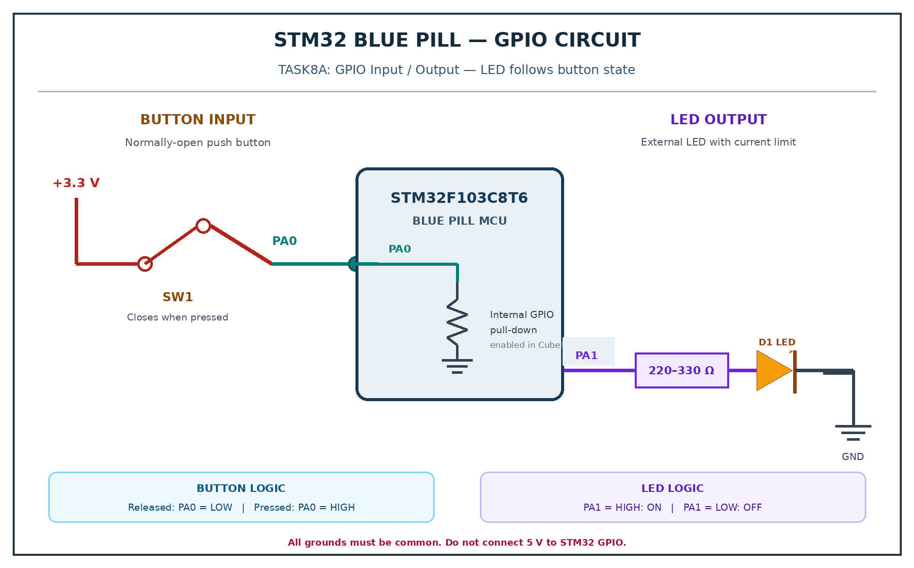

# CAT 8 — Task 8A: GPIO Input / Output

## Experiment details

- **Course:** 25CS2741 — Fundamentals of Internet of Things + Lab
- **Assessment:** Continuous Lab Evaluation 8A
- **Date on assignment:** 18/09/2026
- **Experiment:** STM32 GPIO Bring-Up and Switch-Controlled LED
- **Board:** STM32 Blue Pill (STM32F103C8T6)
- **IDE / framework:** STM32CubeMX, Keil MDK-ARM, STM32 HAL

## Aim

Interface a push-button and an LED with the STM32 and configure GPIO so that the LED follows the switch state.

## Hardware setup

| Component / signal | Connection | Configuration |
|---|---|---|
| Push-button SW1 | 3.3 V to PA0 when pressed | PA0 input with internal pull-down |
| LED D1 anode | PA1 through 220–330 Ω resistor | PA1 push-pull output |
| LED D1 cathode | GND | Common ground |
| Board power | USB or regulated 3.3 V supply | Do not apply 5 V to a 3.3 V GPIO |

Use a normally-open push-button. When released, PA0 is held LOW by the internal pull-down. When pressed, PA0 reads HIGH. The external LED must have a current-limiting resistor in series.

## Circuit diagram

## Working principle

The firmware initializes the HAL, configures the system clock, and initializes GPIOA. PA0 is configured as an input with `GPIO_PULLDOWN`; PA1 is configured as a push-pull output. The main loop continuously reads PA0 using `HAL_GPIO_ReadPin()`.

- If PA0 is HIGH (button pressed), PA1 is written HIGH and the LED turns ON.
- If PA0 is LOW (button released), PA1 is written LOW and the LED turns OFF.

This is level-based polling: the LED mirrors the current button state.

## Core logic / pseudocode

1. Initialize HAL and system clock.
2. Configure PA0 as input with pull-down.
3. Configure PA1 as push-pull output and initialize it LOW.
4. Repeatedly read PA0.
5. If PA0 is HIGH, write HIGH to PA1.
6. Otherwise, write LOW to PA1.
7. Repeat continuously.

## HAL functions used

- `HAL_Init()` — initialize the HAL library and SysTick.
- `HAL_GPIO_ReadPin()` — read the push-button input.
- `HAL_GPIO_WritePin()` — set the LED output.
- `HAL_RCC_OscConfig()` and `HAL_RCC_ClockConfig()` — configure the system clock.

## Expected observation / result

The LED should turn ON while the button is pressed and turn OFF when the button is released. Record the result observed on your own hardware before submission.

## Inference

This task demonstrates digital GPIO input and output using STM32 HAL. The internal pull-down provides a defined LOW input while the switch is open, preventing PA0 from floating. Polling the input allows the LED output to follow the switch state.

## Files

- `Core/Src/main.c` — application source code.
- `Core/Inc/main.h` — application and HAL declarations.
- `Blinky.ioc` — STM32CubeMX configuration.
- `MDK-ARM/Blinky.uvprojx` — Keil project.
- `MDK-ARM/startup_stm32f103xb.s` — startup code.
- `circuit.png` — wiring diagram.

## Safety and wiring checks

- Confirm the switch connects PA0 to **3.3 V**, not 5 V.
- Confirm PA0 is configured with `GPIO_PULLDOWN`.
- Use a 220–330 Ω series resistor with the external LED.
- Check LED polarity: anode toward PA1 through the resistor; cathode toward GND.
