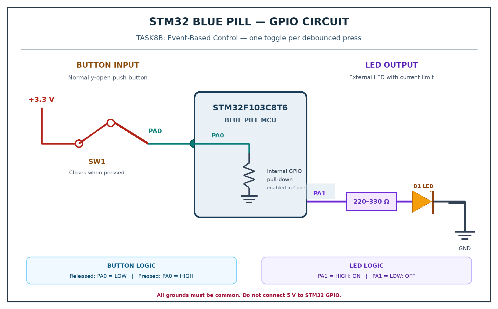

# CAT 8 — Task 8B: Event-Based Control (Switch Debouncing)

## Experiment details

- **Course:** 25CS2741 — Fundamentals of Internet of Things + Lab
- **Assessment:** Continuous Lab Evaluation 8B
- **Date on assignment:** 18/09/2026
- **Experiment:** STM32 Event-Based Control (Switch Debouncing)
- **Board:** STM32 Blue Pill (STM32F103C8T6)
- **IDE / framework:** STM32CubeMX, Keil MDK-ARM, STM32 HAL

## Aim

Modify the GPIO application so that each valid switch press toggles the LED exactly once. Investigate mechanical switch bounce and implement a software debounce solution.

## Hardware setup

| Component / signal | Connection | Configuration |
|---|---|---|
| Push-button SW1 | 3.3 V to PA0 when pressed | PA0 input with internal pull-down |
| LED D1 anode | PA1 through 220–330 Ω resistor | PA1 push-pull output |
| LED D1 cathode | GND | Common ground |

The switch is normally open. PA0 is LOW while released and HIGH while pressed. The LED is an external LED connected to PA1 through a current-limiting resistor.

## Circuit diagram

## Working principle

Mechanical push-buttons can produce several rapid HIGH/LOW transitions when the contacts make or break. These transitions are called switch bounce. Without debouncing, one physical press may be detected as multiple presses.

The firmware uses a non-blocking debounce routine called `Switch_Update()`:

1. Read PA0 using `HAL_GPIO_ReadPin()`.
2. Compare the raw input with the previous raw reading.
3. If the raw state changes, save the current time using `HAL_GetTick()`.
4. Accept the new state only after it remains unchanged for at least **30 ms**.
5. When the accepted stable state becomes HIGH (pressed), call `HAL_GPIO_TogglePin()` on PA1 exactly once.

The loop continues running during the debounce interval; it does not use `HAL_Delay()`.

## Core logic / pseudocode

1. Initialize HAL, clock, PA0 input pull-down and PA1 output.
2. Set the debounce interval to 30 ms.
3. Read the raw switch state.
4. If the raw state changes, update the previous state and timestamp.
5. If the raw state has remained stable for 30 ms and differs from the accepted state, accept it.
6. If the accepted state is HIGH, toggle PA1 once.
7. Repeat continuously.

## HAL functions used

- `HAL_GPIO_ReadPin()` — sample the raw switch input.
- `HAL_GetTick()` — measure how long the input has remained stable.
- `HAL_GPIO_TogglePin()` — toggle the LED on a valid press event.
- `HAL_Init()` — initialize HAL and the SysTick time base.

## Expected observation / result

Each physical press should produce one LED toggle, even if the switch contacts bounce. Releasing the button should not produce another toggle. Record the result observed on your own hardware before submission.

## Inference

This task demonstrates event-based input handling and software debouncing. By accepting a state transition only after 30 ms of stability, the program filters short contact-bounce transitions and generates one toggle event per valid press.

## Files

- `Core/Src/main.c` — application source and debounce function.
- `Core/Inc/main.h` — application and HAL declarations.
- `Blinky.ioc` — STM32CubeMX configuration.
- `MDK-ARM/Blinky.uvprojx` — Keil project.
- `MDK-ARM/startup_stm32f103xb.s` — startup code.
- `circuit.png` — wiring diagram.

## Safety and wiring checks

- Connect the button between PA0 and 3.3 V; PA0 uses an internal pull-down.
- Never apply 5 V to PA0.
- Use a 220–330 Ω series resistor with the LED.
- Check the LED anode/cathode orientation before powering the board.
