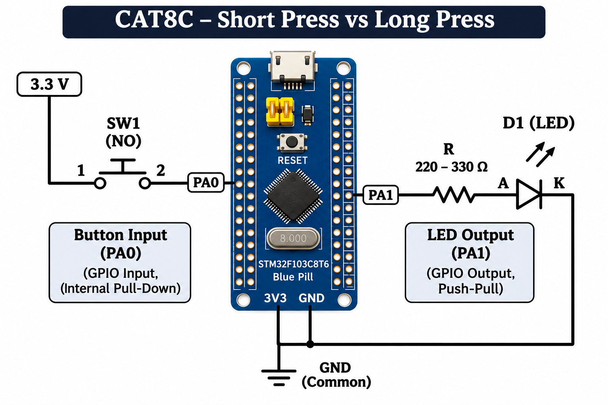

# CAT8C – STM32 Short Press vs Long Press Classification

## Experiment Details

- **Course:** 25CS2741 – Fundamentals of Internet of Things + Lab
- **Assessment:** Continuous Lab Evaluation 8C
- **Date:** 18/09/2026
- **Experiment:** STM32 Short Press vs Long Press Classification
- **Board:** STM32 Blue Pill (STM32F103C8T6)
- **IDE:** STM32CubeMX and Keil MDK-ARM
- **Framework:** STM32 HAL

## 1. Aim

To classify push-button presses based on their duration and control the LED accordingly using a non-blocking state machine.

### Required System Behaviour

| User Action | System Response |
|---|---|
| Short press (< 1 second) | Toggle LED |
| Long press (≥ 1 second) | Enter continuous blinking mode |
| Next short press | Stop blinking |
| Long press again | Return to blinking mode |

## 2. Hardware Requirements

- STM32 Blue Pill development board
- Normally-open push-button
- External LED
- 220–330 Ω current-limiting resistor
- Breadboard and jumper wires
- USB power supply

## 3. Hardware Connections

| Component / Signal | Connection |
|---|---|
| Push-button SW1 | 3.3 V to PA0 when pressed |
| LED D1 Anode | PA1 through 220–330 Ω resistor |
| LED D1 Cathode | GND |
| Board Power | USB / regulated 3.3 V |

### GPIO Configuration

| Pin | Mode | Configuration |
|---|---|---|
| PA0 | GPIO Input | Internal Pull-Down |
| PA1 | GPIO Output | Push-Pull |

## 4. Circuit Diagram

## 5. Working Principle

The firmware uses a non-blocking state machine to distinguish between short and long button presses. It uses `HAL_GetTick()` to measure the duration without blocking the main application.

The operation is as follows:

1. `Switch_Update()` debounces the PA0 input using a 30 ms stability interval.
2. When a debounced press is detected, the firmware records the start time using `pressStart = HAL_GetTick()`.
3. The main loop continues executing while the button is held.
4. When a debounced release is detected, the firmware calculates:

   `duration = HAL_GetTick() - pressStart`

5. If the duration is at least 1000 ms, blinking mode is enabled.
6. If the duration is less than 1000 ms:
   - If blinking is active, blinking is stopped.
   - Otherwise, the LED is toggled.
7. While blinking mode is active, the LED toggles every 250 ms using `HAL_GetTick()`.

A subsequent long press enables blinking mode again after it has been stopped.

## 6. Core Logic / Pseudocode

1. Initialize HAL and configure the system clock.
2. Configure PA0 as GPIO input with internal pull-down.
3. Configure PA1 as push-pull output.
4. Set the debounce interval to 30 ms.
5. Set the long-press threshold to 1000 ms.
6. Set the LED blinking interval to 250 ms.
7. Continuously execute the non-blocking switch update routine.
8. On a debounced press, record the start timestamp.
9. On a debounced release, calculate the press duration.
10. If duration ≥ 1000 ms, enable blinking mode.
11. Otherwise:
    - Stop blinking if blinking is active.
    - Toggle the LED if blinking is inactive.
12. If blinking is active and 250 ms has elapsed, toggle the LED.
13. Repeat continuously.

## 7. HAL Functions Used

- `HAL_Init()` – Initializes the HAL library and SysTick time base.
- `HAL_GPIO_ReadPin()` – Reads the push-button input.
- `HAL_GPIO_WritePin()` – Initializes and controls the LED output.
- `HAL_GPIO_TogglePin()` – Toggles the LED state.
- `HAL_GetTick()` – Measures press duration and schedules LED blinking.

## 8. Important Constraint

**Do not use `HAL_Delay()` or other blocking delays for long-press detection.**

The application must continue executing while the button is held. `HAL_GetTick()` is used for press-duration measurement, debounce timing and non-blocking LED blinking.

Elapsed-time calculations use tick subtraction, allowing correct timing across the tick counter rollover.

## 9. Expected Observation

| User Action | Expected Result |
|---|---|
| Short press (< 1 second) | LED toggles once |
| Long press (≥ 1 second) | LED enters continuous blinking mode |
| Short press while blinking | Blinking stops |
| Subsequent long press | Blinking mode starts again |

## 10. Inference

The experiment demonstrates non-blocking time-based event classification using the STM32 HAL millisecond tick.

The button press duration determines whether the application performs a short-press toggle or enters continuous blinking mode. The debounce and blink timing mechanisms allow the main loop to remain responsive without blocking delays.

## 11. Project Files

- `Core/Src/main.c` – Main application source code, state machine and timing logic.
- `Core/Inc/main.h` – Application and HAL declarations.
- `Blinky.ioc` – STM32CubeMX configuration.
- `MDK-ARM/Blinky.uvprojx` – Keil project file.
- `MDK-ARM/startup_stm32f103xb.s` – Startup assembly file.
- `circuit.png` – Hardware circuit diagram.

## 12. Safety and Wiring Checks

- Connect the push-button between PA0 and 3.3 V.
- Ensure PA0 is configured with an internal pull-down.
- Never apply 5 V directly to PA0.
- Use a 220–330 Ω series resistor with the external LED.
- Verify LED anode and cathode orientation before powering the board.
- Ensure all circuit components share a common ground.
