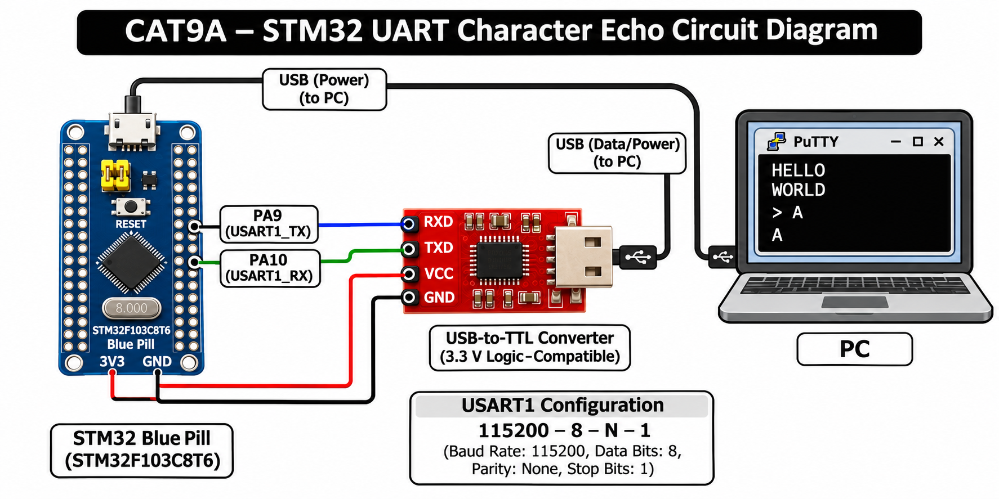

# CAT9A – STM32 UART Communication and Character Echo

## Experiment Details

- **Course:** 25CS2741 – Fundamentals of Internet of Things + Lab
- **Assessment:** Continuous Assessment 9A (CAT9)
- **Date:** 28/09/2026
- **Experiment:** STM32 UART Command Controlled LED – Basic UART Communication and Character Echo
- **Board:** STM32 Blue Pill (STM32F103C8T6)
- **IDE:** STM32CubeMX and Keil MDK-ARM
- **Communication Interface:** USART1
- **Terminal:** PuTTY
- **Baud Rate:** 115200

## 1. Aim

To establish bidirectional UART communication between the STM32 microcontroller and a PC using a USB-to-TTL converter, transmit a startup message and echo every received character back to the terminal.

## 2. Hardware Requirements

- STM32 Blue Pill (STM32F103C8T6)
- USB-to-TTL converter
- USB cable
- Jumper wires
- PC with PuTTY terminal software

## 3. Hardware Connections

| STM32 Pin | USB-to-TTL Pin | Function |
|---|---|---|
| PA9 (USART1_TX) | RXD | STM32 transmission |
| PA10 (USART1_RX) | TXD | STM32 reception |
| GND | GND | Common ground |

### UART Configuration

| Parameter | Configuration |
|---|---|
| Peripheral | USART1 |
| Baud Rate | 115200 |
| Data Bits | 8 |
| Parity | None |
| Stop Bits | 1 |
| Mode | Transmit and Receive |

## 4. Circuit Diagram



## 5. Working Principle

The STM32 initializes USART1 with a baud rate of 115200 and an 8-N-1 configuration.

After initialization, the firmware transmits the startup message:

`HELLO\r\nWORLD\r\n`

The program then continuously checks for incoming characters from the PC using `HAL_UART_Receive()`.

Whenever a character is received, the same character is immediately transmitted back using `HAL_UART_Transmit()`.

### Carriage Return and Line Feed

- `\r` (Carriage Return) moves the terminal cursor to the beginning of the current line.
- `\n` (Line Feed) moves the cursor to the next line.
- Both control characters are used together for proper line formatting in PuTTY.

## 6. Core Logic / Pseudocode

1. Initialize the HAL library and system clock.
2. Configure USART1 for 115200 baud, 8 data bits, no parity and 1 stop bit.
3. Initialize UART transmission and reception.
4. Transmit the startup message `HELLO\r\nWORLD\r\n`.
5. Continuously wait for an incoming character using `HAL_UART_Receive()`.
6. Store the received character.
7. Transmit the same character back using `HAL_UART_Transmit()`.
8. Repeat continuously.

## 7. HAL Functions Used

- `HAL_Init()` – Initializes the STM32 HAL library.
- `HAL_UART_Receive()` – Receives data through USART1.
- `HAL_UART_Transmit()` – Transmits data through USART1.
- `HAL_RCC_OscConfig()` – Configures the system oscillator.
- `HAL_RCC_ClockConfig()` – Configures the system clock.

## 8. Expected Observation

- PuTTY should display the startup message:

  ```text
  HELLO
  WORLD
  ```

- Characters typed into PuTTY should be received by the STM32.
- Each received character should be echoed back to the terminal.
- Communication should operate at 115200 baud with 8-N-1 configuration.

## 9. Inference

The experiment demonstrates bidirectional serial communication between an STM32 microcontroller and a PC using the USART1 peripheral.

Character echo confirms successful UART transmission and reception. The use of both Carriage Return and Line Feed ensures proper text formatting in terminal emulators such as PuTTY.

## 10. Safety and Connection Checks

- Connect STM32 TX (PA9) to converter RXD.
- Connect STM32 RX (PA10) to converter TXD.
- Ensure a common ground between the STM32 and USB-to-TTL converter.
- Configure PuTTY with the correct COM port and 115200 baud rate.
- Use compatible 3.3 V UART logic levels.
- Do not connect the converter's 5 V output directly to STM32 GPIO pins.
