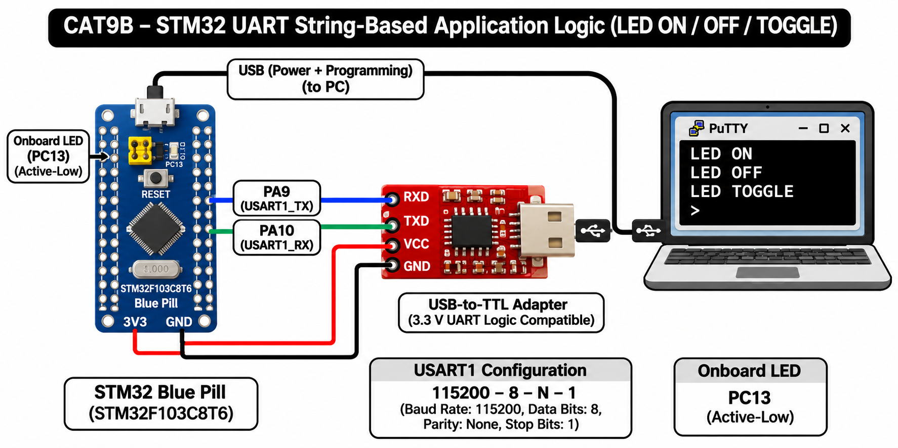

# CAT 9 — Task 9B: String-Based Application Logic (LED ON / OFF / TOGGLE)

## Experiment details

- **Course:** 25CS2741 — Fundamentals of Internet of Things + Lab
- **Assessment:** Continuous Lab Evaluation 9B
- **Date:** 28/09/2026
- **Experiment:** STM32 UART Command Controlled LED
- **Board:** STM32 Blue Pill (STM32F103C8T6)
- **IDE / Framework:** STM32CubeMX, Keil MDK-ARM, STM32 HAL
- **Communication:** USART1, 115200 baud, 8-N-1

## Aim

Control the onboard LED using text commands received through UART from a PC terminal.

- `LED ON` – Turn ON the onboard LED.
- `LED OFF` – Turn OFF the onboard LED.
- `LED TOGGLE` – Change the current LED state.

## Hardware setup

| Component / Signal | Connection | Configuration |
|---|---|---|
| USB-to-TTL RXD | PA9 (USART1_TX) | UART transmission |
| USB-to-TTL TXD | PA10 (USART1_RX) | UART reception |
| USB-to-TTL GND | Blue Pill GND | Common ground |
| USB-to-TTL VCC | 3.3 V supply | Only if required by the adapter |
| Onboard LED | PC13 | GPIO output, active-low |

UART communication is configured at 115200 baud with 8 data bits, no parity and 1 stop bit.

## Circuit diagram

## Working principle

The STM32 initializes USART1 and configures PC13 as a GPIO output. Incoming characters are collected into a string buffer until a carriage return (`\r`) or line feed (`\n`) is received.

The completed string is null-terminated and compared using `strcmp()`.

- If the command is `LED ON`, the onboard LED is turned ON.
- If the command is `LED OFF`, the onboard LED is turned OFF.
- If the command is `LED TOGGLE`, the LED state is inverted.
- An appropriate confirmation message is transmitted back to the PC terminal.

**Note:** The Blue Pill onboard LED connected to PC13 is typically active-low.

## Core logic / pseudocode

1. Initialize HAL, system clock and GPIO.
2. Configure USART1 at 115200 baud.
3. Configure PC13 as a GPIO output.
4. Receive characters using `HAL_UART_Receive()`.
5. Append received characters to the command buffer.
6. Detect `\r` or `\n` as the command terminator.
7. Null-terminate the received string.
8. Compare the command using `strcmp()`.
9. Execute the corresponding LED operation.
10. Transmit the confirmation message using `HAL_UART_Transmit()`.
11. Clear the buffer and continue receiving commands.

## HAL functions used

- `HAL_Init()` — Initialize the HAL library.
- `HAL_UART_Init()` — Initialize UART communication.
- `HAL_UART_Receive()` — Receive command characters.
- `HAL_UART_Transmit()` — Send confirmation messages.
- `HAL_GPIO_WritePin()` — Control the onboard LED.
- `HAL_GPIO_TogglePin()` — Toggle the LED state.
- `strcmp()` — Compare received commands.

## Expected observation / result

| Command sent through PuTTY | Expected response |
|---|---|
| `LED ON` | Onboard LED turns ON |
| `LED OFF` | Onboard LED turns OFF |
| `LED TOGGLE` | Onboard LED changes its state |

The STM32 should also return a confirmation message for each recognized command.

## Inference

This experiment demonstrates string-based command processing using UART communication. By collecting incoming characters and identifying complete commands, the STM32 can interpret text instructions and control GPIO outputs, forming a basic embedded command-line interface.

## Files

- `Core/Src/main.c` — UART command processing and LED control.
- `Core/Inc/main.h` — Application and HAL declarations.
- `Blinky.ioc` — STM32CubeMX configuration.
- `MDK-ARM/Blinky.uvprojx` — Keil project.
- `MDK-ARM/startup_stm32f103xb.s` — Startup code.
- `circuit.png` — Hardware connection diagram.

## Safety and configuration checks

- Configure USART1 for 115200-8-N-1.
- Connect UART TX and RX lines in crossed configuration.
- Ensure the USB-to-TTL adapter uses 3.3 V UART logic.
- Connect the adapter and Blue Pill grounds together.
- Verify PC13 LED polarity before configuring its initial output state.
